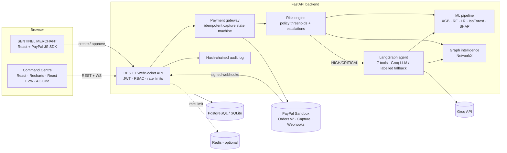
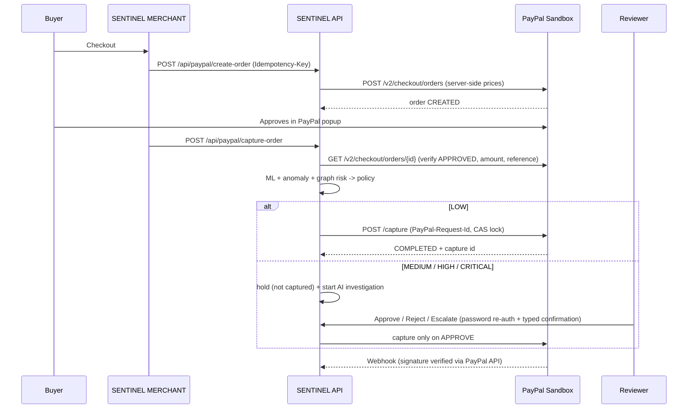

# SENTINEL

**Autonomous AI-powered payment risk intelligence on PayPal.**
*Every Transaction. Every Connection. Every Risk. Understood.*

SENTINEL sits between PayPal buyer approval and PayPal capture. Every checkout on the demo marketplace
(**SENTINEL MERCHANT**) creates a real PayPal Sandbox order; when the buyer approves, the backend retrieves the
order from PayPal, verifies amount and ownership, and runs a risk engine that combines **machine learning**
(XGBoost / Random Forest / Logistic Regression + Isolation Forest, explained with SHAP), **graph intelligence**
(NetworkX over stored customer–device–destination relationships) and an **autonomous LangGraph investigation agent**.
LOW risk is captured automatically; everything else is held and **never captured without a human reviewer's
authenticated approval**. Every step is written to a hash-chained audit trail.

> All customers, merchants, devices and historical transactions are **synthetic demo data**. PayPal runs in **Sandbox**; no real money moves.

---

## Architecture



### Payment lifecycle



---

## Quick start (local, no Docker)

Prerequisites: Python 3.12+ and Node 20+.

```bash
cp .env.example .env
```

```bash
cd backend && python -m venv .venv && .venv/Scripts/pip install -r requirements.txt
```

(On macOS/Linux use `.venv/bin/pip` and `.venv/bin/python`.)

```bash
cd backend && .venv/Scripts/python -m app.migrate
```

```bash
cd backend && .venv/Scripts/python -m uvicorn app.main:app --port 8000
```

The first start seeds the synthetic world (100 customers, 25 merchants, 150 devices, 2,000 transactions),
trains all four models and scores history (~30–60 s). Then, in a second terminal:

```bash
cd frontend && npm install && npm run dev
```

| What | URL |
|---|---|
| Storefront (SENTINEL MERCHANT) | http://localhost:5173/shop |
| Command Centre | http://localhost:5173/console |
| Backend | http://localhost:8000 |
| Swagger / OpenAPI | http://localhost:8000/docs |

### Demo accounts (synthetic)

Password for all: value of `SEED_PASSWORD` (default `SentinelDemo!2026`).

| Email | Role | Use |
|---|---|---|
| reviewer@sentinel.dev | REVIEWER | Review queue, approve / reject / escalate |
| admin@sentinel.dev | ADMIN | Risk policy, retraining, escalated decisions |
| analyst@sentinel.dev | ANALYST | Read-only investigation |
| ava@shopper.sentinel.dev | CUSTOMER | Demo A – normal buyer |
| ben@shopper.sentinel.dev | CUSTOMER | Demo B – anomalous buyer |
| cara@shopper.sentinel.dev | CUSTOMER | Demo C – fraud-ring member |

## Quick start (Docker Compose, PostgreSQL + Redis)

```bash
cp .env.example .env
```

```bash
docker compose up --build
```

Frontend http://localhost:8080 · API http://localhost:8000 · Swagger http://localhost:8000/docs

---

## PayPal Sandbox setup

1. Sign in at https://developer.paypal.com → **Apps & Credentials** → **Sandbox** → **Create App** (Merchant).
2. Copy **Client ID** and **Secret** into `PAYPAL_CLIENT_ID` / `PAYPAL_CLIENT_SECRET` in `.env`. Keep `PAYPAL_BASE_URL=https://api-m.sandbox.paypal.com`.
3. Under **Sandbox → Accounts**, use (or create) a *Personal* sandbox account to approve payments in the PayPal popup.
4. Webhooks (optional but recommended): in the app, add a webhook pointing to `https://<your-backend>/api/paypal/webhook`
   (needs a public URL, e.g. Render or a tunnel) subscribed to `CHECKOUT.ORDER.APPROVED` and `PAYMENT.CAPTURE.*`; put its ID in `PAYPAL_WEBHOOK_ID`.
5. Restart the backend. **Settings** in the console shows integration status.

Without credentials the checkout clearly says PayPal is not configured; Sentinel **never** fakes a PayPal response.
Everything else (risk engine, graph, agent, review, audit, demos via *Run risk pipeline*) keeps working.

## Groq (optional)

Set `GROQ_API_KEY` (and optionally `GROQ_MODEL`). Without it, or if a Groq call fails, the agent produces a
**DETERMINISTIC FALLBACK** report that is labelled as such in the API and UI.

## The three demos

Launch from **Command Centre → Demonstration scenarios**:

| | Scenario | Expected |
|---|---|---|
| A | Ava buys a $76 pour-over set + coffee on her usual laptop | LOW → automatic PayPal capture, audit entry |
| B | Ben (avg ≈ $38) buys a $1,849 ultrabook from a new device | 43× average → escalated to MEDIUM, SHAP explanation, held for review |
| C | Cara buys a $500 gift card from an emulator shared by a ring | graph policy → HIGH, AI investigation recommends REJECT, human decision |

Each scenario has two buttons: **Run risk pipeline** (DEMO transaction through the real engine, no PayPal) and
**PayPal checkout** (sets the shopper persona/device and opens the real Sandbox checkout).

## Tests

```bash
cd backend && .venv/Scripts/python -m pytest -q
```

23 tests cover transaction creation, ML predictions, risk classification, graph detection, agent tools and
evidence validation, the investigation workflow, PayPal order creation, capture, duplicate-capture prevention,
ownership, amount-mismatch protection, webhook signature verification and de-duplication, reviewer decisions
(re-auth, confirmation, escalation, RBAC), high-risk bypass prevention and audit-chain tamper detection.
PayPal is emulated in tests by an `httpx.MockTransport` test double (`tests/conftest.py`); the app never uses it.

## API (Swagger at `/docs`)

| Method | Path | Notes |
|---|---|---|
| POST | /api/auth/login · GET /api/auth/me | JWT |
| POST/GET | /api/transactions · /api/transactions/{id} | staff |
| POST | /api/risk/assess · GET /api/risk/metrics | |
| POST | /api/investigations/start · GET /api/investigations/{id} | async LangGraph run |
| GET | /api/graph/entity/{id} · /api/graph/transaction/{id} · /api/graph/overview | |
| POST | /api/paypal/create-order | shopper, `Idempotency-Key` header |
| POST | /api/paypal/capture-order | verify → assess → capture or hold |
| GET | /api/paypal/order/{id} | refresh from PayPal (owner or staff) |
| POST | /api/paypal/webhook | signature verified via PayPal |
| POST | /api/reviews/{txn}/decision · GET /api/reviews/queue | REVIEWER/ADMIN |
| GET | /api/dashboard/metrics · /api/audit · /api/audit/verify | |
| GET/PUT | /api/settings/risk-policy | PUT = ADMIN |
| POST | /api/models/retrain | ADMIN |
| POST | /api/demo/scenarios/{A,B,C}/run · /api/demo/simulator | |
| WS | /ws/transactions?token=… | live events (staff) |

## Deployment (Render)

`render.yaml` is a Blueprint: **New → Blueprint** → select the repo. It creates PostgreSQL, the Docker backend
(`sentinel-api`) and the static frontend (`sentinel-web`). Then set `PAYPAL_CLIENT_ID`, `PAYPAL_CLIENT_SECRET`,
`PAYPAL_WEBHOOK_ID`, `GROQ_API_KEY`, `SEED_PASSWORD` on `sentinel-api`, and adjust `CORS_ORIGINS` /
`VITE_API_URL` if your service names differ. Netlify works for the frontend too (build `npm run build`,
publish `dist`, env `VITE_API_URL`, SPA redirect to `/index.html`).

## Project structure

```
backend/
  app/
    main.py            FastAPI app, lifespan (migrate, seed, train), WebSocket
    config.py db.py models.py security.py audit.py infra.py migrate.py
    ml/                features.py (point-in-time), train.py, explain.py (SHAP), predictor.py, service.py
    graph/engine.py    NetworkX graph, detection, explorer views
    agent/             tools.py (7 tools), workflow.py (LangGraph + Groq + fallback)
    paypal/client.py   OAuth, Orders v2, Capture, webhook verification
    services/          risk.py, transactions.py, payments.py, review.py, demo.py
    routers/           auth, transactions, intel, paypal, ops
    seed/              synthetic.py (generator), loader.py
  alembic/             migrations
  tests/               pytest suite
frontend/
  src/pages/shop/      catalogue, product, cart, checkout (PayPal), orders, demo launcher
  src/pages/console/   9 console sections + investigation workspace
  src/components/      GraphView (React Flow), ShapChart, DecisionPanel, UI kit
docs/                  TECHNICAL.md, SUBMISSION.md (description + demo script)
```

## Known limitations

See [docs/TECHNICAL.md](docs/TECHNICAL.md#current-limitations). Highlights: models are trained on synthetic data;
CAPTURE-intent orders held for review must be decided within PayPal's approval window; webhooks need a public URL;
single-process WebSocket fan-out.

## License

MIT — see [LICENSE](LICENSE).
