# PROJECT SENTINEL

**Autonomous AI-Powered Payment Risk Intelligence & Protection Platform**

*Combining Machine Learning, Graph Intelligence, Agentic AI and PayPal Payment Infrastructure.*

Prepared for: PayPal AI Hackathon 2026 · Prepared by: Tanisha Dey · October 2026

> **Disclaimer.** Hackathon prototype using PayPal Sandbox and synthetic data. Not an officially deployed PayPal fraud prevention product.

This file is the editable source of the PDF documentation set (regenerate with `backend/.venv/Scripts/python SENTINEL_DOCUMENTATION/source/build_pdfs.py`).

---

# PART 1: Executive Overview

## 1.1 What is Sentinel?

Sentinel is a payment protection layer that sits between a customer approving a payment in PayPal and the moment the merchant actually collects the money. It looks at each payment, decides how risky it is, explains why, and only lets PayPal collect the funds when that is safe or when a human reviewer has approved it.

The project has two faces:

- **SENTINEL MERCHANT**: a demo online shop where a shopper picks products and pays with PayPal (Sandbox).
- **The Sentinel console**: a dashboard used by risk analysts and reviewers to watch transactions, see why something was flagged, explore relationships between accounts, run an AI investigation and approve or reject held payments.

> In one sentence: Sentinel decides, with evidence, whether money should move, and keeps a human in charge of the decisions that cannot be undone.

## 1.2 Why was Sentinel created?

Online payments are fast, and fraud is fast too. Many fraud checks look at one payment at a time and return a score with no explanation. That leaves two problems. First, organised fraud is often invisible at the level of a single payment: ten accounts that share one phone and send money to the same wallet each look normal on their own. Second, when a payment is flagged, someone still has to work out why, which takes time while the customer waits.

Sentinel was built for the PayPal AI Hackathon 2026 to show how payment infrastructure, machine learning, graph analysis and an AI investigator can work together in one coherent workflow.

## 1.3 What problem does it solve?

Inside this prototype, Sentinel solves a specific, well-defined problem: *"Before PayPal captures an approved payment, decide whether it is safe to capture, explain the decision, and make sure risky payments cannot be captured without an authenticated human approval."*

## 1.4 Who would benefit?

| Who | Benefit |
|---|---|
| Merchants | Fewer fraudulent captures and the chargebacks that follow; fewer genuine customers wrongly declined, because flagged payments are reviewed rather than auto-rejected. |
| Risk reviewers and analysts | A ready-made case file: transaction details, customer history, model explanation, relationship graph and an evidence-cited recommendation. |
| Genuine customers | Normal purchases go through automatically; unusual ones are checked by a person instead of being silently blocked. |
| Engineering and compliance teams | Every decision is recorded in a tamper-evident audit log. |

## 1.5 How does it work? (simple version)

1. A shopper adds items to the cart and clicks the PayPal button.
2. Sentinel's server creates a real PayPal order with prices taken from its own catalogue.
3. The shopper approves the payment in the PayPal window.
4. Before any money is collected, Sentinel asks PayPal for the order, checks the amount and that it belongs to this shopper, and then scores the risk.
5. Low-risk payments are captured automatically. Anything else is **held**, which means PayPal has the buyer's approval but no money has been collected.
6. For high-risk payments an AI investigator collects evidence and writes a report with a recommendation.
7. A reviewer signs in again, reads the evidence and approves, rejects or escalates. Only an approval can trigger the PayPal capture.

## 1.6 What makes it different?

- **Risk is enforced at the exact point where money moves.** The capture step itself checks that the payment was either LOW risk or approved by a reviewer.
- **Three kinds of intelligence, one decision.** A supervised ML model, an unsupervised anomaly detector and a relationship graph each contribute, and the policy explains which one raised the risk.
- **An AI investigator that cannot make things up.** Every finding in its report must cite an evidence item produced by a tool; anything else is removed automatically.
- **A clear separation of truth.** PayPal's payment status is only ever copied from PayPal. Sentinel's risk decision is stored separately, so a held payment is never shown as paid.

## 1.7 Why PayPal integration is important

Without a real payment system, a fraud model is just a classifier. With PayPal, Sentinel controls a real lifecycle: order creation, buyer approval and capture. The risk decision has a concrete consequence (capture or do not capture), and PayPal's own idempotency and webhook signature verification are part of the safety design.

## 1.8 Where AI fits

| AI component | What it does in Sentinel |
|---|---|
| Machine learning (Random Forest, XGBoost, Logistic Regression) | Estimates the probability that a payment is fraudulent from 26 behavioural features. |
| Anomaly detection (Isolation Forest) | Measures how unusual a payment is compared with all training payments, without using labels. |
| Explainable AI (SHAP) | Shows which features pushed the score up or down for each individual payment. |
| Graph intelligence (NetworkX) | Finds shared devices, money loops and clusters of linked accounts. |
| Agentic AI (LangGraph + Groq) | Runs a multi-step investigation with tools and writes an evidence-backed report. A rule-based fallback is used, and labelled, when Groq is not configured. |

## 1.9 The one-minute explanation

> "Sentinel protects PayPal checkouts. When a shopper pays, our server creates a real PayPal Sandbox order. After the shopper approves it, and before we capture any money, Sentinel scores the payment with a machine-learning model, checks how unusual it is, and looks at a graph of which accounts share devices or send money to the same wallets. Normal payments are captured straight away. Suspicious ones are held: PayPal shows the order as approved, but nothing is collected. An AI agent then gathers evidence with seven tools and writes a report where every claim points to a piece of evidence. A reviewer re-enters their password and approves, rejects or escalates, and only an approval lets PayPal capture the money. Everything is recorded in a hash-chained audit log. It all runs on synthetic data and PayPal Sandbox, so no real customers or money are involved."

# PART 2: Problem Statement

## 2.1 The broader problem

Digital payments keep growing, and so does the attack surface. The patterns below are widely discussed in the payments industry; they are described here as general context, not as statistics measured by this project.

- **Suspicious payment behaviour**: purchases far above a customer's normal spending, at unusual hours, or in quick bursts.
- **Account takeover (ATO)**: a criminal logs into a real customer's account from a new device, often from a far-away location, and buys high-value, resellable goods.
- **Card testing**: many tiny failed payments to check which stolen details work, followed by a large purchase.
- **Coordinated fraud networks**: many accounts controlled by the same group share devices and move money to the same "mule" destinations, or pass money around in circles.
- **Rule-based limits**: fixed rules (for example "block anything above $1,000") are easy to explain but easy to evade, and they block many genuine customers.
- **False positives**: every genuine customer wrongly declined is lost revenue and a damaged relationship.
- **Detection is not enough**: a score with no explanation still leaves an analyst to rebuild the story by hand.
- **Explainability matters**: payment decisions affect real people; reviewers, auditors and customers need to understand why a payment was held.

## 2.2 A realistic hypothetical example

Cara's account has a short purchase history. On a Tuesday afternoon she buys a $500 digital gift card. On its own that is not alarming: the amount is about 1.5 times her average, and she has used this phone before. But that phone is also used by three other accounts, and those accounts have repeatedly sent money to two external wallets that are known to have received funds linked to chargebacks. A model that only looks at Cara's payment sees an ordinary purchase. A system that looks at the relationships sees a likely fraud ring. This exact situation is reproduced as Demo Scenario C (Part 14), where the ML model scored the payment at about 0.33 but the graph policy raised it to HIGH.

## 2.3 Industry challenges versus what this prototype solves

| General industry challenge | What Sentinel's prototype actually does |
|---|---|
| Fraud at very large scale | Not addressed. The prototype processes a few thousand synthetic transactions in one process. |
| Individual anomalous payments | Addressed: ML score, anomaly percentile, amount-versus-average escalation, SHAP explanation. |
| Coordinated networks | Addressed for shared devices, flagged destinations, circular wallet transfers and linked clusters on synthetic data. |
| Unexplained decisions | Addressed: SHAP factors, policy notes and evidence-cited reports. |
| Money moving before review | Addressed: capture is gated and protected against bypass and duplication. |
| Real-world model accuracy | Not demonstrated. Models are trained and evaluated on synthetic data only. |

## 2.4 Formal problem statement

> Given a PayPal order that a buyer has approved but that has not yet been captured, determine (a) whether the order is authentic and belongs to the requesting customer, (b) the risk that the payment is fraudulent, using the customer's history, the payment's context and the customer's relationships to other accounts, devices and destinations, and (c) whether the order may be captured automatically or must be held for an authenticated human decision, while producing an explanation and an auditable record for every step, and guaranteeing that a held order can never be captured without approval and that no order is captured twice.

# PART 3: Project Objectives

## 3.1 Primary objectives

| Objective | How it is met in the code | Why it matters |
|---|---|---|
| Detect suspicious transactions | Every transaction is scored by the primary ML model, the Isolation Forest and graph signals (`services/risk.py`). | Catches risky payments before money moves. |
| Estimate transaction risk | Fraud probability is mapped to LOW / MEDIUM / HIGH / CRITICAL by configurable thresholds, with escalation rules. | Lets the business choose how cautious to be. |
| Identify suspicious financial relationships | NetworkX graph over stored relationships detects shared devices, cycles, flagged destinations and suspicious clusters (`graph/engine.py`). | Organised fraud is invisible one payment at a time. |
| Investigate suspicious activity using AI | LangGraph workflow with seven tools; Groq LLM when configured, labelled rule-based fallback otherwise (`agent/`). | Saves analyst time and produces a consistent case file. |
| Integrate payment protection with PayPal Sandbox | Orders v2 create, get and capture; webhook verification; idempotency (`paypal/client.py`, `services/payments.py`). | Makes the risk decision consequential. |
| Provide explainable recommendations | SHAP top factors, policy notes, evidence keys E1...En in reports. | Reviewers and auditors can verify every claim. |
| Maintain a complete audit trail | SHA-256 hash-chained `audit_logs` table with a verification endpoint (`audit.py`). | Proves what happened and detects tampering. |

## 3.2 Secondary objectives

- Real-time visibility: WebSocket event stream that refreshes the console.
- Role-based operation: ADMIN, REVIEWER, ANALYST and CUSTOMER roles.
- Reproducible demos: three scenarios that can be launched from the console.
- Honest evaluation: hold-out metrics only, primary model chosen by PR-AUC.
- Deployability: Docker Compose, Render Blueprint, Alembic migrations.

# PART 4: Proposed Solution

## 4.1 The customer journey, step by step

1. **Customer selects a product.** The storefront lists 16 synthetic products from synthetic sellers. A cart can only contain items from one seller, because each checkout pays one merchant.
2. **Customer initiates PayPal Checkout.** The PayPal JavaScript SDK renders the PayPal button. Clicking it calls Sentinel's `POST /api/paypal/create-order` with the cart, a device identifier and an `Idempotency-Key`.
3. **Backend creates a PayPal order.** The server recalculates prices from its own catalogue, creates a Sentinel transaction with status `AWAITING_APPROVAL`, and calls PayPal `POST /v2/checkout/orders` with `intent = CAPTURE`. The PayPal order ID is returned to the browser.
4. **Customer approves in PayPal.** The buyer logs in to a PayPal Sandbox personal account and approves. No money has moved yet.
5. **Sentinel assesses risk before capture.** The browser calls `POST /api/paypal/capture-order`. The server fetches the order from PayPal, checks it is `APPROVED`, that amount, currency and reference match, and that the caller owns it.
6. **ML models analyse the transaction.** 26 point-in-time features are computed and scored by the primary model; the Isolation Forest gives an anomaly percentile; SHAP explains the score.
7. **Graph intelligence examines relationships.** The customer, device and destination are checked for shared-device rings, flagged destinations, circular loops and suspicious clusters.
8. **The AI agent investigates.** For HIGH and CRITICAL payments (by default) an investigation starts automatically in the background.
9. **A human reviewer examines the evidence.** The reviewer approves, rejects or escalates after re-entering their password and typing the transaction ID.
10. **Payment is captured or not.** LOW risk is captured automatically. An APPROVE decision triggers the capture. REJECT leaves the PayPal order uncaptured.
11. **Everything is recorded.** PayPal responses go to `payment_events`, decisions to `reviewer_decisions`, and every action to the hash-chained `audit_logs`.

## 4.2 Normal, medium-risk and high-risk scenarios

| Scenario | Policy outcome | PayPal outcome | Human involvement |
|---|---|---|---|
| Normal (LOW) | `CLEARED`, then capture | Capture called with a stable `PayPal-Request-Id`; status `COMPLETED` comes from PayPal | None |
| Medium | `HELD_FOR_VERIFICATION` | Order stays `APPROVED`; nothing captured | Reviewer verifies and decides |
| High / Critical | `HELD_FOR_REVIEW`, AI investigation started | Order stays `APPROVED`; nothing captured | Reviewer decides; escalated cases need an ADMIN |

> Important: a held payment is not a failed payment. The buyer has approved it in PayPal, but Sentinel has not asked PayPal to collect the money. The interface shows PayPal status and Sentinel status side by side so this is never confused.

# PART 5: System Architecture

## 5.1 High-level architecture

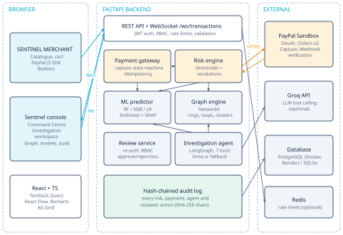

*High-level system architecture*

The system has three tiers. The **browser** runs a single React application with two areas: the SENTINEL MERCHANT storefront (shoppers) and the console (staff). The **FastAPI backend** exposes REST endpoints and one WebSocket, and contains the payment gateway, risk engine, ML predictor, graph engine, investigation agent and audit log. The **external services** are PayPal Sandbox (always used for real payments), Groq (optional, for the LLM agent), the database (PostgreSQL in Docker/Render, SQLite locally) and Redis (optional, for shared rate limiting).

Data flow in one sentence: the browser calls the API; the API stores state in the database, talks to PayPal for every payment operation, calls the risk engine (which uses the ML model and the graph), starts the agent for high-risk payments, records every step in the audit log, and pushes events back to the console over the WebSocket.

## 5.2 Frontend architecture

- **Routing** (`react-router-dom`): `/shop/*` for the storefront, `/console/*` for the console, `/login`.
- **State and data**: TanStack Query caches every API call. The `LiveProvider` opens one authenticated WebSocket and invalidates the relevant queries when events arrive, so every screen updates without manual refresh.
- **Auth**: `AuthProvider` stores the JWT in `sessionStorage` and exposes the current user and role. Console routes require a staff role.
- **Visualisation**: Recharts (dashboard and model charts), React Flow (relationship graph), AG Grid Community (transactions table), Framer Motion (transitions).
- **Payments**: `@paypal/react-paypal-js` renders PayPal Buttons using the public client ID returned by `GET /api/paypal/config`. The secret never reaches the browser.

## 5.3 Backend architecture

| Module | Responsibility |
|---|---|
| `main.py` | FastAPI app, lifespan (migrations, first-run seeding and training, model artifact recovery), CORS, security headers, WebSocket. |
| `routers/` | `auth`, `transactions` (transactions, risk, reviews), `intel` (investigations, graph), `paypal` (checkout, webhook, storefront), `ops` (dashboard, audit, models, settings, demos). |
| `services/payments.py` | PayPal order lifecycle, capture state machine, webhook handling. |
| `services/risk.py` | Feature state, scoring, policy thresholds and escalations. |
| `services/review.py` | Reviewer decisions with re-authentication and RBAC. |
| `services/transactions.py` | Transaction creation and risk routing. |
| `ml/` | Feature engineering, training, SHAP explanation, prediction. |
| `graph/engine.py` | Graph persistence, NetworkX analysis, explorer views. |
| `agent/` | Seven investigation tools and the LangGraph workflow. |
| `audit.py` | Hash-chained audit log and chain verification. |
| `infra.py` | Rate limiter (Redis or memory) and WebSocket broadcaster. |

## 5.4 Payment processing sequence

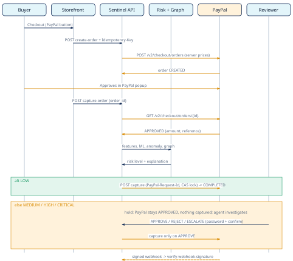

*Payment processing sequence (Orders v2 with Sentinel risk gating)*

The sequence shows the two independent approvals in the lifecycle: the buyer's approval in PayPal, and Sentinel's risk approval. The capture call to PayPal only happens if both exist. If the risk policy holds the payment, the reviewer's APPROVE decision replaces the automatic approval, and the same capture function is used, with the same protections.

## 5.5 Real-time communication

`ws://<host>/ws/transactions?token=<JWT>` accepts staff tokens only. The backend broadcasts `transaction.created`, `transaction.assessed`, `transaction.updated`, `payment.updated`, `investigation.step`, `investigation.completed` and `decision.made`. Because many events come from background threads (the agent, the simulator), the broadcaster uses `asyncio.run_coroutine_threadsafe` with the server's event loop.

## 5.6 Deployment architecture

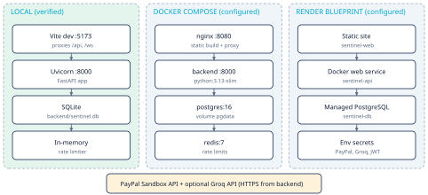

*Deployment architecture*

Three supported ways to run Sentinel:

| Mode | Components | Status |
|---|---|---|
| Local | Uvicorn + Vite dev server, SQLite, in-memory rate limiting | Run and verified during development |
| Docker Compose | PostgreSQL 16, Redis 7, backend container, nginx serving the built frontend and proxying `/api` and `/ws` | Configuration written; not run during development because Docker was not running on the build machine |
| Render + Netlify (live) | Render free web service built from `Dockerfile.render` (SQLite seeded at build time, shifted to today on start) + Netlify static frontend | **Live** at https://sentinel-payment-risk.netlify.app since 1 Nov 2026 |

On hosts with ephemeral disks, the backend retrains automatically at start-up if the active model file is missing.

# PART 6: Technology Stack Explained

## 6.1 Frontend

| Technology | What it is | Why chosen / problem solved | Where used | Talks to |
|---|---|---|---|---|
| React 18 | UI component library | Component model for two applications in one bundle | All screens | TanStack Query, router |
| TypeScript 5.8 | Typed JavaScript | Catches API shape mistakes at build time | Entire frontend | Compiler only |
| Vite 6 | Build tool and dev server | Fast reloads; dev proxy for `/api` and `/ws` | Build and dev | Proxies to FastAPI |
| Tailwind CSS 3.4 | Utility CSS framework | Consistent dark fintech design tokens | All styling | Build step |
| Framer Motion 12 | Animation library | Smooth panel and list transitions | Cards, modals, feeds | React |
| Recharts 2 | Chart library | Area, bar, line, pie, ROC/PR and SHAP charts | Command Centre, Fraud Intelligence, Model Analytics | API data via TanStack Query |
| React Flow (@xyflow/react 12) | Interactive node graph | Pan, zoom, hover and click on relationship graphs | Network Graph, Investigation workspace | `/api/graph/*` |
| AG Grid Community 33 | Data grid | Filtering, sorting, quick search, pagination and CSV export over 2,000+ rows | Live Transactions | `/api/transactions` |
| TanStack Query 5 | Server-state cache | Caching, polling, invalidation from WebSocket events | All data access | REST API |
| Lucide React | Icon set | Consistent icons | Everywhere | n/a |
| PayPal React SDK (@paypal/react-paypal-js 8) | Wrapper for PayPal JS SDK | Renders PayPal Buttons, handles approval popup | Checkout | PayPal + Sentinel API |

AG Grid was evaluated as the brief asked: it adds real value for filtering and searching thousands of rows. Row grouping is an Enterprise feature, so risk "grouping" is done with filter chips instead.

## 6.2 Backend, data and infrastructure

| Technology | What it is | Why chosen / problem solved | Where used |
|---|---|---|---|
| Python 3.13 | Language | Same language for API, ML and graph code | Backend |
| FastAPI 0.115 | Async web framework | Typed endpoints, automatic OpenAPI/Swagger, native WebSockets | `main.py`, `routers/` |
| Pydantic 2 / pydantic-settings | Validation and settings | Strict request validation; secrets loaded from environment | Request models, `config.py` |
| SQLAlchemy 2 | ORM | One model layer for PostgreSQL and SQLite; atomic compare-and-set updates | `models.py`, services |
| Alembic 1.15 | Migrations | Versioned schema changes | `alembic/versions/0001_initial_schema.py` |
| PostgreSQL 16 | Relational database | Production database in Docker/Render | `docker-compose.yml`, `render.yaml` |
| SQLite | Embedded database | Zero-setup local development | Default `DATABASE_URL` |
| Redis 7 (optional) | In-memory store | Shared rate-limit counters across instances; falls back to memory if absent | `infra.py` |
| httpx | HTTP client | PayPal REST calls; injectable transport for tests | `paypal/client.py` |
| PyJWT, bcrypt | Auth libraries | Signed tokens, salted password hashing | `security.py` |
| Docker, Docker Compose | Containers | Reproducible multi-service environment | `Dockerfile`s, compose |
| Render | Cloud platform | Blueprint deployment of DB, API and static site | `render.yaml` |
| WebSockets (FastAPI/Starlette) | Push channel | Live console updates | `/ws/transactions` |

## 6.3 Machine learning, graph and AI

| Technology | Where used | Role |
|---|---|---|
| pandas 3, NumPy 2 | `ml/train.py`, `ml/predictor.py` | Feature tables, metrics computation |
| scikit-learn 1.9 | `ml/train.py` | Logistic Regression, Random Forest, Isolation Forest, imputation, scaling, metrics, stratified split |
| XGBoost 3.4 | `ml/train.py` | Gradient-boosted tree classifier |
| SHAP 0.54 | `ml/explain.py` | TreeExplainer / LinearExplainer attributions per prediction and globally |
| joblib | `ml/train.py` | Model bundle persistence |
| NetworkX 3.7 | `graph/engine.py` | Graph construction, connected components, `simple_cycles`, Kamada-Kawai layout |
| LangGraph 1.2 | `agent/workflow.py` | State-machine orchestration of the investigation |
| Groq SDK 1.7 | `agent/workflow.py` | LLM tool calling (default model `llama-3.3-70b-versatile`, configurable) |

## 6.4 Payment

| Component | Where used |
|---|---|
| PayPal JavaScript SDK (Buttons) | `frontend/src/pages/shop/Checkout.tsx` |
| OAuth 2.0 client credentials | `PayPalClient._access_token()` |
| Orders API v2: create, get, capture | `PayPalClient.create_order / get_order / capture_order` |
| Webhook signature verification API | `PayPalClient.verify_webhook()` |
| PayPal Sandbox | Default `PAYPAL_BASE_URL = https://api-m.sandbox.paypal.com` |


# PART 7: Machine Learning Deep Dive

## 7.1 Dataset structure

All data is **synthetic** and generated deterministically (seed 2026) by `backend/app/seed/synthetic.py`. No real people, cards or accounts are involved.

| Item | Count | Notes |
|---|---|---|
| Customers | 100 | Home city and spending profile each; three are demo personas (Ava, Ben, Cara) |
| Merchants | 25 | 5 in high-risk categories: gift cards, crypto on-ramp, electronics resale, gaming credits, prepaid mobile |
| Devices | 150 | Personal, secondary, shared household, attacker and emulator devices |
| Payment destinations | 46 | 25 merchant payout accounts, 19 customer-owned wallets, 2 flagged "mule" wallets |
| Products | 16 | Storefront catalogue |
| Historical transactions | 2,000 | Spread over 90 days |
| Labelled fraud | 142 (7.1%) | Ground-truth label `is_fraud` exists only for synthetic history |

The generator creates labelled behaviour patterns, including deliberately hard cases:

| Pattern (scenario tag) | Transactions | Label |
|---|---|---|
| NORMAL | 1,800 | Legitimate (3% random declines) |
| RING_DEVICE_FARM | 60 | Mostly fraud (92%): 9 accounts, shared emulator devices, night bursts, mule wallets |
| CIRCULAR_RING | 24 | Fraud: 4 accounts passing money in a loop |
| ACCOUNT_TAKEOVER | 20 | Fraud: new device, far-away location, 8 to 25 times normal spend |
| CARD_TESTING | 26 | Fraud: tiny failed attempts then a large purchase |
| FRIENDLY_FRAUD | 16 | Fraud that looks completely normal (label noise) |
| LEGIT_LARGE | 22 | Legitimate large purchases (hard negatives) |
| P2P_LEGIT | 32 | Legitimate wallet transfers |

Friendly fraud and legitimate large purchases are included on purpose: they stop the models from reaching unrealistic perfect scores.

## 7.2 Pipeline overview

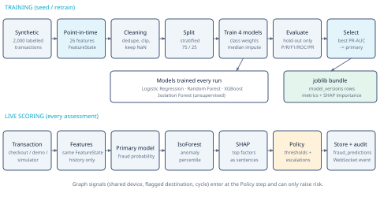

*Machine-learning fraud detection pipeline*

## 7.3 Feature engineering (point-in-time)

A transaction's features are computed **only from transactions that happened before it**. `FeatureState` replays history in time order for training, and the same class is used for live scoring. This prevents "looking into the future", and it guarantees the model sees identical feature definitions in training and production (no train/serve skew).

| Group | Features (26 total) |
|---|---|
| Amount | `amount`, `log_amount` |
| Frequency | `txn_count_1h`, `txn_count_24h`, `txn_count_7d`, `hours_since_prev` |
| Customer baseline | `cust_avg_amount`, `amount_to_avg_ratio`, `amount_zscore` |
| Merchant | `merchant_risk_score`, `merchant_high_risk_category`, `is_p2p_transfer` |
| Device | `device_distinct_customers`, `device_new_for_customer`, `customer_distinct_devices_30d` |
| Geography | `geo_distance_prev_km`, `geo_velocity_kmh`, `distance_from_home_km` (haversine) |
| Failures | `failed_count_24h`, `failed_count_7d` |
| Network | `destination_distinct_customers`, `destination_flagged`, `customer_flagged_dest_interactions` |
| Time | `hour_of_day`, `is_night`, `is_first_txn` |

## 7.4 Preprocessing, split and class imbalance

- **Cleaning**: drop unlabelled rows, duplicate IDs and non-positive amounts; clip extreme values (speed at 5,000 km/h, ratio at 200, z-score to [-50, 200]).
- **Missing values**: the first transaction of a customer has no history, so some features are missing. They stay `NaN` and are filled with the training median inside each model pipeline (`SimpleImputer`), so the test set never influences imputation.
- **Split**: stratified 75/25 hold-out with `random_state=42`: 1,500 training rows and 500 test rows (36 fraud cases in the test set).
- **Class imbalance** (about 1 fraud per 13 legitimate): `class_weight="balanced"` for Logistic Regression, `class_weight="balanced_subsample"` for Random Forest, and `scale_pos_weight = negatives / positives` for XGBoost.

## 7.5 The four algorithms

### Logistic Regression

**In plain words:** it gives each feature a weight, adds them up, and squashes the total into a probability between 0 and 1.

**Technically:** p(fraud | x) = 1 / (1 + e^-(w·x + b)). The weights are learned by minimising the log-loss with L2 regularisation (C = 0.5). Features are standardised first.

**Advantages:** fast, stable, easy to interpret. **Limitations:** it only draws straight decision boundaries, so interactions (for example "new device AND far away") must be engineered by hand. **Role in Sentinel:** a transparent baseline. In v1 it had the best ROC-AUC (0.964) but lower precision (0.842).

### Random Forest

**In plain words:** it grows hundreds of decision trees, each on a random sample of the data and features, and lets them vote.

**Technically:** bagging of CART trees (300 trees, min_samples_leaf = 2). The predicted probability is the average of the trees' leaf class proportions. Randomisation reduces variance compared with a single tree.

**Advantages:** captures non-linear interactions, robust to outliers, needs little tuning. **Limitations:** larger model, probabilities are not calibrated, less extrapolation. **Role in Sentinel:** the **primary model in v1**, because it had the highest PR-AUC (0.914).

### XGBoost

**In plain words:** it builds trees one after another, each new tree fixing the mistakes of the previous ones.

**Technically:** gradient boosting. Each tree is fitted to the gradient of the log-loss; leaf weights use second-order (Hessian) information; regularisation (`reg_lambda = 1.5`, depth 4, learning rate 0.07, 250 trees, row and column subsampling) controls overfitting. `scale_pos_weight` up-weights fraud cases.

**Advantages:** usually the strongest family on tabular data; handles missing values; fast. **Limitations:** more hyperparameters; can overfit small data. **Role in Sentinel:** trained and evaluated every time; it would be selected automatically if it had the best PR-AUC. In v1 it came third by PR-AUC (0.903), so it was not the primary model. This is reported honestly rather than forcing XGBoost to be primary.

### Isolation Forest

**In plain words:** unusual points are easier to "isolate" with random cuts than normal ones.

**Technically:** an ensemble of random isolation trees; the anomaly score is based on the average path length needed to isolate a point (shorter path = more anomalous). It is trained **without labels**. Sentinel converts the raw score into a percentile of the training scores ("more anomalous than 95% of training transactions").

**Advantages:** detects new kinds of unusual behaviour that labels do not cover. **Limitations:** "unusual" is not the same as "fraudulent". **Role in Sentinel:** a second opinion used by the policy (anomaly percentile at or above 0.98 raises LOW to at least MEDIUM) and shown to reviewers.

## 7.6 Model selection and evaluation

The primary model is chosen automatically as the supervised model with the highest **PR-AUC** on the hold-out set. All numbers below are the stored results of model version v1 (trained on 1,500 rows, evaluated on 500 rows the models never saw), at threshold 0.5 for the supervised models. Data generation and training are deterministic, so a fresh seed reproduces exactly these numbers:

| Model | Precision | Recall | F1 | ROC-AUC | PR-AUC | TN | FP | FN | TP |
|---|---|---|---|---|---|---|---|---|---|
| Random Forest (primary) | 0.970 | 0.889 | 0.927 | 0.954 | 0.914 | 463 | 1 | 4 | 32 |
| Logistic Regression | 0.842 | 0.889 | 0.865 | 0.964 | 0.911 | 458 | 6 | 4 | 32 |
| XGBoost | 0.939 | 0.861 | 0.899 | 0.958 | 0.903 | 462 | 2 | 5 | 31 |
| Isolation Forest (unsupervised) | 0.849 | 0.778 | 0.812 | 0.944 | 0.862 | 459 | 5 | 8 | 28 |

> These metrics describe performance on synthetic data generated by the project itself. They demonstrate that the pipeline is correct and evaluated honestly; they are not evidence of real-world fraud detection accuracy.

## 7.7 Understanding the metrics

| Metric | Meaning | In fraud terms |
|---|---|---|
| Precision | TP / (TP + FP) | Of the payments we flagged, how many were really fraud. Low precision = annoyed genuine customers. |
| Recall | TP / (TP + FN) | Of all fraud, how much we caught. Low recall = fraud slips through. |
| F1 | Harmonic mean of precision and recall | One number that balances both. |
| ROC-AUC | Probability a random fraud case is scored above a random legitimate one | Threshold-free ranking quality; can look optimistic when fraud is rare. |
| PR-AUC (average precision) | Area under the precision-recall curve | Focuses on the rare fraud class; the most informative single number under imbalance. |
| Confusion matrix | TN, FP, FN, TP counts | Shows exactly which mistakes are made. |
| False positive | Genuine payment flagged | Customer friction, manual review cost. |
| False negative | Fraud not flagged | Financial loss, chargebacks. |

**Why accuracy is not enough:** with 7% fraud, a model that says "never fraud" is 93% accurate and catches nothing. That is why Sentinel reports precision, recall, F1, ROC-AUC and PR-AUC and selects by PR-AUC.

## 7.8 Explainable AI with SHAP

SHAP (SHapley Additive exPlanations) splits one prediction into contributions from each feature, based on Shapley values from cooperative game theory: each feature's contribution is its average marginal effect over all orderings of features. For each prediction, the contributions plus the model's baseline add up to the model output.

Sentinel uses `TreeExplainer` for tree models and `LinearExplainer` for Logistic Regression. The explanation space is reported with every prediction: Random Forest values are in probability space; XGBoost and Logistic Regression values are in log-odds.

For each payment, positive contributions are converted into sentences a reviewer can check, for example *"Amount is 43.4x the customer's historical average"* or *"Device has been used by 4 distinct accounts"*. Globally, the mean absolute SHAP value on the test set ranks the features. The top ten for v1 are:

| Rank | Feature | Mean abs SHAP |
|---|---|---|
| 1 | amount | 0.0701 |
| 2 | log_amount | 0.0698 |
| 3 | distance_from_home_km | 0.0662 |
| 4 | hour_of_day | 0.0636 |
| 5 | is_night | 0.0382 |
| 6 | hours_since_prev | 0.0311 |
| 7 | destination_distinct_customers | 0.0211 |
| 8 | geo_distance_prev_km | 0.0204 |
| 9 | merchant_risk_score | 0.0182 |
| 10 | geo_velocity_kmh | 0.0176 |

Note: `hour_of_day` and `is_night` rank highly because the synthetic fraud ring operates at night. That is a property of the synthetic generator and a known limitation (Part 17).

## 7.9 Risk scoring workflow

1. Compute features from history (`FeatureState.features`).
2. Primary model gives `fraud_probability`; Isolation Forest gives `anomaly_score` (percentile); SHAP gives contributions.
3. Classify: LOW below 0.30, MEDIUM below 0.70, HIGH below 0.90, otherwise CRITICAL (editable by ADMIN).
4. Escalations (they can only raise risk): anomaly percentile at least 0.98 gives at least MEDIUM; amount at least 10 times average gives at least MEDIUM; graph signals (flagged destination, device shared by 3 or more accounts, circular loop) give at least HIGH.
5. Store a `fraud_predictions` row with the probability, scores, level, action, top factors, SHAP values, features, policy notes and latency; write an audit entry; broadcast an event.

Recommended actions: LOW `AUTO_APPROVE`, MEDIUM `ADDITIONAL_VERIFICATION`, HIGH `MANUAL_REVIEW`, CRITICAL `MANUAL_REVIEW_AND_INVESTIGATE`.

## 7.10 Retraining and feedback

`POST /api/models/retrain` (ADMIN) creates a new model version. It uses ground-truth labels for synthetic history and reviewer decisions for live payments (REJECT = fraud, APPROVE = legitimate). Previous versions remain stored.

# PART 8: Graph Intelligence

## 8.1 Why transaction-level analysis is not enough

A model scores one payment using that customer's history. A fraud ring is designed so that each payment looks normal. The evidence is in the **connections**: one device used by several accounts, several accounts paying the same wallet, money going round in a circle. Graph analysis makes those connections visible.

## 8.2 Architecture

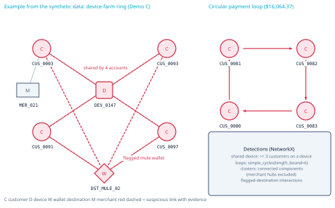

*Graph intelligence: suspicious structures found in the synthetic data*

Every transaction writes relationships into two tables: `graph_entities` (nodes) and `graph_relationships` (edges, with a weight counting repeats). The engine loads them into a NetworkX directed graph and then builds an **entity projection** that collapses transaction nodes into aggregated edges between customers, devices, destinations and merchants, each carrying a count, total amount and transaction IDs.

| Node type | Example |
|---|---|
| CUSTOMER | CUS_0003 (Cara Novak) |
| MERCHANT | MER_021 (VaultGift Digital) |
| DEVICE | DEV_0147 (Android emulator) |
| DESTINATION | DST_MULE_02 (flagged external wallet) |
| TRANSACTION | TXN_100542 |

| Edge type | Meaning |
|---|---|
| USES_DEVICE | customer used device |
| MADE_PAYMENT | customer made transaction |
| VIA_DEVICE | transaction made on device |
| PAID_TO | transaction paid destination |
| PAID_MERCHANT | transaction paid merchant |
| OWNS_WALLET | customer owns wallet destination |

## 8.3 Detection algorithms

- **Shared devices:** device nodes connected to 3 or more customers.
- **Circular payments:** a directed customer-to-customer money-flow graph (payer to the owner of the wallet paid) searched with `networkx.simple_cycles(length_bound=6)`; loops of 3 or more accounts are reported.
- **Suspicious clusters:** connected components over customers, devices and wallets. Merchants and merchant payout accounts are excluded, otherwise everyone would be connected through popular shops. A cluster is suspicious if it contains a shared device, a flagged destination, a cycle member, or has mean account risk of at least 0.5.
- **Flagged destination interactions:** every account and payment that reached a flagged wallet.
- **Graph risk score:** a 0 to 1 score per customer from these signals (cycle 0.9, flagged destination 0.85, shared device 0.6 plus 0.05 per account up to 8, suspicious cluster 0.5 plus half the mean risk).
- **Traversal for views:** two-hop breadth-first expansion that never passes through merchant hubs; layout by Kamada-Kawai per connected component.

**Community detection** (for example Louvain) is **not implemented**; connected components are used. See Future Scope.

## 8.4 What the graph found in the synthetic data

| Finding | Detail |
|---|---|
| Entities / relationships | 2,321 / 8,097 (freshly seeded database) |
| Shared device DEV_0147 | 4 accounts: CUS_0003, CUS_0091, CUS_0093, CUS_0097 |
| Shared device DEV_0148 | 3 accounts: CUS_0090, CUS_0094, CUS_0096 |
| Circular loop | CUS_0081 to CUS_0082 to CUS_0083 to CUS_0080 and back, $16,064.37 in total |
| Flagged DST_MULE_01 | 16 payments, $11,238.59, from 7 accounts |
| Flagged DST_MULE_02 | 18 payments, $9,831.23, from 9 accounts |
| Suspicious clusters | 4 (cluster 1: 9 accounts, 2 shared devices, 2 flagged destinations; cluster 8: the 4-account loop) |

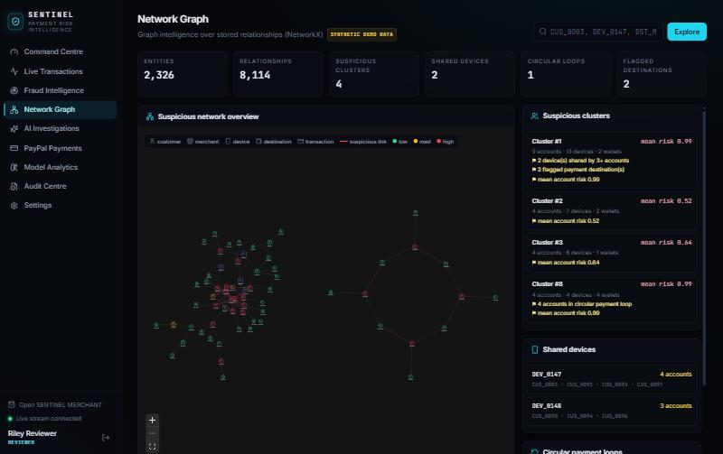

*Network Graph overview: the device-farm cluster (left) and the four-account circular payment loop (right).*

## 8.5 How graph findings become evidence

The `GraphInvestigationTool` returns the customer's signals; the `EvidenceCollectionTool` converts each into a typed evidence item such as *"E6 HIGH SHARED_DEVICE: Device DEV_0147 is shared by 4 accounts (CUS_0003, CUS_0091, CUS_0093, CUS_0097)"*. Explorer edges carry the same evidence strings and transaction IDs, so a reviewer can click a red edge and open the underlying transactions.

# PART 9: Agentic AI Investigation System

## 9.1 What "agentic" means here

| Type | Behaviour |
|---|---|
| Traditional chatbot | Answers questions from its training; no access to your data. |
| Basic LLM application | Sends a prompt (perhaps with some data) and returns text. |
| Tool-using agent | The model decides to call functions (tools) that fetch real data, then uses the results. |
| Multi-step investigation workflow | A defined sequence of steps with shared state, tool calls, validation and a structured output. |

Sentinel's investigator is the last kind: a LangGraph state machine whose fixed steps always run the core tools, followed by an analysis step in which an LLM may call more tools before submitting a structured report.

## 9.2 The workflow

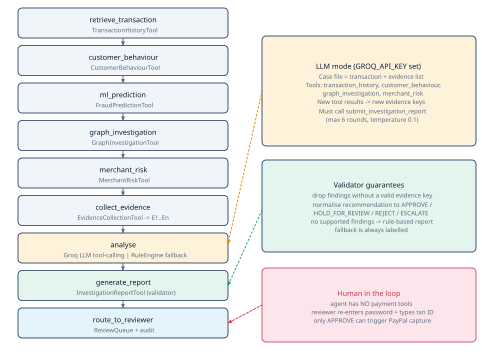

*LangGraph investigation agent workflow*

| Node | Tool | Output |
|---|---|---|
| retrieve_transaction | TransactionHistoryTool | Focal transaction and up to 25 prior transactions |
| customer_behaviour | CustomerBehaviourTool | Average, median, devices, failures, distance from home, speed since previous |
| ml_prediction | FraudPredictionTool | Stored prediction, SHAP factors, policy notes (assesses first if none exists) |
| graph_investigation | GraphInvestigationTool | Shared devices, flagged destinations, cycles, cluster |
| merchant_risk | MerchantRiskTool | Merchant profile, or destination analysis for peer-to-peer transfers |
| collect_evidence | EvidenceCollectionTool | Evidence items E1...En with severity and "mitigating" flags |
| analyse | Groq LLM, or RuleEngine | Draft report |
| generate_report | InvestigationReportTool | Validated report; evidence stored in `investigation_evidence` |
| route_to_reviewer | ReviewQueue | Recommendation routed; audit entry |

**State management:** a typed `InvState` dictionary carries the transaction ID, related entity IDs, tool outputs, draft, report and mode between nodes. Each step's start time, duration, status and summary is saved to `investigations.steps` and broadcast over the WebSocket, so the console shows progress live.

## 9.3 Tool calling with Groq

When `GROQ_API_KEY` is set, the analysis step sends the case file (transaction plus evidence list) to Groq with five tool definitions: `transaction_history`, `customer_behaviour`, `graph_investigation`, `merchant_risk` and `submit_investigation_report`. The model may call the first four to look at related entities (for example another account on the shared device). Their results become new evidence keys. It must finish by calling `submit_investigation_report` with a structured payload: `risk_level`, `summary`, `findings[{statement, evidence_keys}]`, `recommendation` (APPROVE, HOLD_FOR_REVIEW, REJECT or ESCALATE) and `rationale`. The loop is limited to 6 rounds, with temperature 0.1.

> Verification status: the Groq tool-calling path is implemented but was **not exercised** during development because no Groq API key was available. All investigations shown in this document used the deterministic fallback, and are labelled as such.

## 9.4 Hallucination prevention

1. Evidence is produced deterministically from tool outputs, never by the LLM.
2. The LLM only sees the case file and tool results.
3. `InvestigationReportTool` removes every finding that cites no valid evidence key and lists it under `rejected_findings`.
4. An invalid recommendation is replaced with `HOLD_FOR_REVIEW`.
5. If no supported findings remain, the rule-based report is used instead, with the reason recorded.
6. Tests check that invented keys (for example `E999`) and uncited claims are removed.

## 9.5 Error handling and fallback

If Groq is not configured, or the call fails, times out or does not submit a report within the step budget, the agent produces a rule-based report marked `DETERMINISTIC_FALLBACK` with the reason (for example *"GROQ_API_KEY not set"*). The UI shows "Deterministic rule-based report: not LLM-generated". A tool error marks that step as `ERROR` and the workflow continues; an unexpected exception marks the investigation `FAILED` with the error message.

## 9.6 Why the agent recommends but never acts

Capture, refund and rejection are irreversible financial actions, and LLMs can be wrong. The agent has **no payment tools**. Its only output is a recommendation placed in the review queue. A human with the REVIEWER or ADMIN role must decide, after re-entering their password and typing the transaction ID.

## 9.7 End-to-end example (actual run, Demo C)

| Step | Duration | Result |
|---|---|---|
| Retrieve transaction | 15.4 ms | CUS_0003 has 8 transactions; focal TXN_563TG7BVLJ $500.00 |
| Analyse customer behaviour | 6.1 ms | 7 prior transactions, average $327.57, 2 devices, 0 failures |
| ML prediction + SHAP | 4.3 ms | random_forest v1 scored 0.333 (final level HIGH); anomaly percentile 0.947 |
| Graph connections | 3.0 ms | 1 shared device, 1 flagged destination link, suspicious cluster #1 (9 accounts) |
| Merchant risk | 5.7 ms | VaultGift Digital: risk 0.72, chargeback rate 6.1% |
| Collect evidence | 1.8 ms | 8 evidence items, 4 high severity |
| Analysis | 1.5 ms | Deterministic (Groq not configured) |
| Generate report | 9.5 ms | REJECT, 5 evidence-backed findings |
| Route to reviewer | 5.7 ms | Recommendation sent to reviewer queue |

The graph step reads the cached graph engine, which is updated incrementally, so it takes milliseconds. The reviewer then rejected the payment with the reason *"Shared emulator device with 4 ring accounts and flagged mule destination (E5, E6)."*

# PART 10: PayPal Integration

## 10.1 Developer platform setup

| Item | How Sentinel uses it |
|---|---|
| PayPal Developer Dashboard | A Sandbox REST app is created under Apps & Credentials. |
| Sandbox environment | `PAYPAL_BASE_URL=https://api-m.sandbox.paypal.com`; no real money moves. |
| Sandbox business account | Owns the REST app and receives captured funds. |
| Sandbox personal account | Used by the tester to approve payments in the PayPal popup. |
| Client ID | Public; sent to the browser by `GET /api/paypal/config` to load the JS SDK. |
| Client secret | Server-only environment variable; never sent to the browser or logged. |
| Webhook ID | `PAYPAL_WEBHOOK_ID`, required to verify webhook signatures. |

## 10.2 Calls Sentinel makes

| Step | PayPal API | Sentinel code |
|---|---|---|
| OAuth token | `POST /v1/oauth2/token` (client credentials, cached until expiry) | `_access_token()` |
| Create order | `POST /v2/checkout/orders` with `intent=CAPTURE`, item breakdown, `reference_id`/`custom_id` = Sentinel transaction ID, `PayPal-Request-Id` | `create_order()` |
| Verify approved order | `GET /v2/checkout/orders/{id}` | `get_order()` |
| Capture | `POST /v2/checkout/orders/{id}/capture` with `PayPal-Request-Id: capture-{order_id}` | `capture_order()` |
| Verify webhook | `POST /v1/notifications/verify-webhook-signature` | `verify_webhook()` |

## 10.3 Payment lifecycle, step by step

1. **PayPal order creation.** Sentinel creates the order; PayPal returns `status: CREATED`. Sentinel stores `paypal_status=CREATED`, `sentinel_status=AWAITING_BUYER_APPROVAL`.
2. **Customer approval.** The buyer approves in PayPal. PayPal's order becomes `APPROVED`. No funds have moved.
3. **Sentinel risk assessment.** On `capture-order`, Sentinel GETs the order, requires `APPROVED`, and checks amount, currency, reference and ownership. A mismatch sets `INTEGRITY_FAILED` and returns HTTP 409. Then it scores the risk.
4. **PayPal capture.** Only for LOW risk (automatic) or after a reviewer's APPROVE.
5. **Confirmed payment status.** Capture ID and capture status are copied from PayPal's response; `PAYMENT.CAPTURE.*` webhooks (when configured) update the same fields.

## 10.4 Two status fields, never mixed

| Field | Written from | Example values |
|---|---|---|
| `paypal_status`, `capture_status`, `capture_id` | PayPal API responses and verified webhooks only | CREATED, APPROVED, COMPLETED; capture COMPLETED / PENDING / DENIED |
| `sentinel_status` | Sentinel's policy and reviewers | AWAITING_BUYER_APPROVAL, CLEARED, HELD_FOR_VERIFICATION, HELD_FOR_REVIEW, ESCALATED, APPROVED_AUTO, APPROVED_BY_REVIEWER, REJECTED, CAPTURE_FAILED, INTEGRITY_FAILED |

A held payment therefore appears as PayPal `APPROVED`, capture "not captured", Sentinel `HELD_FOR_REVIEW`. The shopper sees: *"Payment approved by buyer but held by Sentinel for human review. Funds have NOT been captured."*

## 10.5 Idempotency and duplicate-capture prevention

- **Order creation:** the client sends an `Idempotency-Key`; it is stored as a unique column and forwarded as `PayPal-Request-Id`. A repeated request returns the existing order.
- **Capture lock:** `capture_state` moves from NONE or FAILED to IN_PROGRESS with an atomic `UPDATE ... WHERE capture_state IN ('NONE','FAILED')`. Only the request that changes the row calls PayPal; any other returns "already performed or in progress".
- **PayPal-side idempotency:** a stable `PayPal-Request-Id = capture-{order_id}` means retries cannot capture twice at PayPal either.
- **Reconciliation:** if PayPal answers `ORDER_ALREADY_CAPTURED`, Sentinel GETs the order and copies the real capture.
- **Authorisation re-check:** the capture function itself requires a LOW assessment (automatic) or a stored APPROVE decision (reviewer).

## 10.6 Webhooks

Webhooks are verified with PayPal's verification API using `PAYPAL_WEBHOOK_ID`. Unverified events return HTTP 400 and are audited as `WEBHOOK_REJECTED`; duplicates (same event ID) are ignored. Handled events: `CHECKOUT.ORDER.APPROVED`, `PAYMENT.CAPTURE.COMPLETED`, `.DENIED`, `.PENDING`, `.REFUNDED`, `.REVERSED`. Webhooks need a public HTTPS URL, so they were not received during local development.

## 10.7 Error handling

PayPal errors raise `PayPalError` with HTTP status, issue code and `paypal-debug-id`. The error body is stored in `payment_events` and returned to the client as HTTP 502 with the debug ID. If credentials are missing, payment endpoints return HTTP 503 and the checkout screen explains how to configure PayPal; Sentinel never shows a simulated success.

## 10.8 Honest scope and verification status

- Sentinel **does not** access PayPal's internal fraud systems. It is a merchant-side risk layer that uses public PayPal REST APIs.
- The integration was tested end to end against a **mock PayPal transport** (a test double emulating Sandbox semantics, used only in tests).
- **Live Sandbox calls were not executed during development**, because Sandbox credentials were not available on the build machine. Configuring `PAYPAL_CLIENT_ID` and `PAYPAL_CLIENT_SECRET` and running Demo A and Demo C through checkout is the remaining verification step.

## 10.9 Why PayPal is central, not an add-on

The project's core guarantee, "risky money does not move without a human", only means something if Sentinel controls a real capture step. PayPal's order and capture separation is what makes risk gating possible, and PayPal's request IDs and webhook signatures are part of the safety design.

# PART 11: Database and API Documentation

## 11.1 Entity relationships

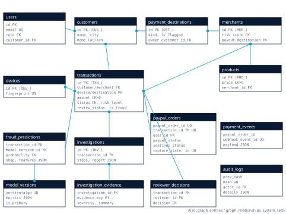

*Database relationships (main tables and foreign keys)*

## 11.2 Tables

All tables are created by Alembic migration `0001_initial_schema`. Timestamps are timezone-aware.

| Table | Purpose | Key fields | Foreign keys | Constraints |
|---|---|---|---|---|
| users | Staff and shopper accounts | id PK, email (unique), password_hash, role, is_active | customer_id to customers | role in ADMIN, REVIEWER, ANALYST, CUSTOMER |
| customers | Synthetic customers | id PK (CUS_...), name, city, country, home_lat/lon, segment | none | none |
| merchants | Sellers | id PK (MER_...), category, risk_score, high_risk_category, chargeback_rate | payout_destination_id to payment_destinations | 0 <= risk_score <= 1 |
| devices | Device fingerprints | id PK (DEV_...), fingerprint (unique), type, os, is_flagged | none | unique fingerprint |
| payment_destinations | Where money lands | id PK (DST_...), kind, is_flagged, flag_reason | owner_customer_id to customers | none |
| products | Storefront catalogue | id PK (PRD_...), name, price, stock | merchant_id to merchants | price > 0 |
| transactions | Every payment | id PK (TXN_...), amount, lat/lon, channel, status, risk_level, review_status, is_fraud | customer, merchant, device, destination | amount > 0; status in allowed list; indexes on customer+time, device+time |
| fraud_predictions | Every risk assessment | probability, anomaly_score, graph_risk_score, risk_level, action, top factors, SHAP, features, policy notes, latency | transaction_id, model_version_id | 0 <= probability <= 1 |
| model_versions | Trained models | version, algorithm, is_active, is_primary, metrics JSON, artifact_path | none | unique (version, algorithm) |
| investigations | Agent runs | id PK (INV_...), status, mode, steps, report, recommendation | transaction_id, started_by_id | none |
| investigation_evidence | Evidence items | evidence_key, tool_name, category, severity, summary, data | investigation_id | none |
| graph_entities | Graph nodes | entity_type, ref_id, label, risk_score, flagged | none | unique (entity_type, ref_id) |
| graph_relationships | Graph edges | rel_type, weight | source_id, target_id to graph_entities | unique (source, target, type) |
| paypal_orders | PayPal order mirror | paypal_order_id (unique), amount, items, create_idempotency_key (unique), paypal_status, sentinel_status, capture_state, capture_id (unique), capture_status | transaction_id (unique), user_id | amount > 0 |
| payment_events | PayPal API responses and webhooks | source, event_type, webhook_event_id (unique), signature_verified, http_status, paypal_debug_id, payload | none (indexed paypal_order_id) | unique webhook_event_id |
| reviewer_decisions | Human decisions | decision, reason, risk_level_at_decision, payment_outcome | transaction, investigation, reviewer | decision in APPROVE, REJECT, ESCALATE |
| audit_logs | Hash-chained audit trail | actor_label, action, entity, details, prev_hash, hash (unique) | actor_id to users | unique hash |
| system_settings | Key-value settings (risk policy) | key PK, value JSON | none | none |

No card numbers, bank details or PayPal credentials are stored. Payer email and payer ID are stored only if PayPal returns them.

## 11.3 API endpoints

Authentication: `Authorization: Bearer <JWT>` from `POST /api/auth/login`. "Staff" means ADMIN, REVIEWER or ANALYST. Interactive documentation is at `/docs` (Swagger) and `/redoc`.

| Method | Route | Purpose | Auth |
|---|---|---|---|
| POST | /api/auth/login | Email + password to JWT (rate limit 10/min) | Public |
| GET | /api/auth/me | Current user | Any user |
| POST | /api/transactions | Create a synthetic transaction and assess it | Staff |
| GET | /api/transactions | List with filters: risk_level, status, channel, review_status, customer_id, q, limit, offset | Staff |
| GET | /api/transactions/{id} | Full case: customer, merchant, device, destination, predictions, investigations, decisions, PayPal order, events, audit | Staff |
| POST | /api/risk/assess | Re-assess a transaction with the active model | Staff |
| GET | /api/risk/metrics | Active model metrics and risk distribution | Staff |
| POST | /api/investigations/start | Start the agent (asynchronous) | Staff |
| GET | /api/investigations | List investigations | Staff |
| GET | /api/investigations/{id} | Steps, report, evidence | Staff |
| GET | /api/graph/overview | Suspicious clusters, shared devices, cycles, flagged destinations and graph | Staff |
| GET | /api/graph/entity/{id} | Neighbourhood of an entity (hops 1-3) | Staff |
| GET | /api/graph/transaction/{id} | Neighbourhood of a transaction | Staff |
| GET | /api/paypal/config | Public client ID and status (no secrets) | Public |
| POST | /api/paypal/create-order | Create PayPal order; header `Idempotency-Key` required | Shopper |
| POST | /api/paypal/capture-order | Verify, assess, then capture or hold | Order owner |
| GET | /api/paypal/order/{id} | Refresh state from PayPal | Owner or staff |
| GET | /api/paypal/orders | Orders (own for shoppers, all for staff) | Any user |
| GET | /api/paypal/events | PayPal API responses and webhooks | Staff |
| POST | /api/paypal/webhook | Verified PayPal webhooks (rate limit 300/min) | PayPal signature |
| POST | /api/reviews/{txn}/decision | APPROVE / REJECT / ESCALATE with password and confirmation | Reviewer, Admin |
| GET | /api/reviews/queue | Payments awaiting a decision | Staff |
| GET | /api/dashboard/metrics | KPIs, time series, distributions, network and model summary | Staff |
| GET | /api/audit | Audit log with filters | Staff |
| GET | /api/audit/verify | Verify the hash chain | Staff |
| GET | /api/models | All model versions and metrics | Staff |
| GET / POST | /api/models/retrain | Retrain status / start retraining | Staff / Admin |
| GET / PUT | /api/settings/risk-policy | Read / update thresholds | Staff / Admin |
| GET | /api/settings/integrations | PayPal, Groq, database, rate-limiter status | Staff |
| GET | /api/demo/scenarios | Demo scenario definitions | Staff |
| POST | /api/demo/scenarios/{A,B,C}/run | Run a scenario through the risk pipeline (no PayPal order) | Staff |
| GET / POST | /api/demo/simulator | Simulator status / start or stop | Staff |
| GET | /api/shop/products, /api/shop/products/{id}, /api/shop/demo-presets | Storefront data | Public |
| GET | /api/health | Liveness and integration flags | Public |
| WS | /ws/transactions?token= | Live events | Staff token |

## 11.4 Request and response examples

**Create order** (`POST /api/paypal/create-order`, header `Idempotency-Key: 3f6c...`):

```
{"items": [{"product_id": "PRD_005", "quantity": 2}],
 "device_fingerprint": "fp-ava-macbook-air",
 "geo": null}
```

Response (shape from `order_view`; values from the test suite, which uses the mock PayPal transport):

```
{"paypal_order_id": "5O190100001TEST", "transaction_id": "TXN_...",
 "amount": 96.0, "currency": "USD", "paypal_status": "CREATED",
 "sentinel_status": "AWAITING_BUYER_APPROVAL", "capture_state": "NONE",
 "capture_id": null, "capture_status": null, "risk_level": null, ...}
```

**Structured risk result** (`POST /api/risk/assess`, abridged):

```
{"transaction_id": "TXN_563TGV4IBG", "fraud_probability": 0.0661,
 "anomaly_score": 0.954, "risk_level": "MEDIUM", "model_version": "v1",
 "model_algorithm": "random_forest",
 "top_risk_factors": ["Transaction amount $1,849.00",
   "First time this customer has used this device",
   "Amount is 43.4x the customer's historical average"],
 "recommended_action": "ADDITIONAL_VERIFICATION",
 "policy_notes": ["Model score 0.066 (random_forest v1) -> LOW",
   "Amount is 43.4x customer average (>= 10.0x) -> at least MEDIUM"]}
```

**Reviewer decision** (`POST /api/reviews/{txn}/decision`):

```
{"decision": "REJECT",
 "reason": "Shared emulator device with 4 ring accounts and flagged mule destination (E5, E6).",
 "password": "********", "confirm_transaction_id": "TXN_56SIN7VDWC"}
```

**Common errors:** 401 not authenticated, invalid token or re-authentication failed; 403 wrong role or not the order owner; 404 not found; 409 wrong state (for example not approved by buyer, already decided, amount mismatch, policy violation); 422 validation error (structured `errors` list); 429 rate limit; 502 PayPal error with `debug_id`; 503 PayPal not configured.

# PART 12: Security and Reliability

| Area | Implementation |
|---|---|
| Environment variables | All secrets come from environment / `.env` (`pydantic-settings`); `.env` is git-ignored; `.env.example` has blank values; blank values fall back to safe defaults. |
| Credential management | PayPal secret is used only server-side for OAuth; the client ID is the only PayPal value sent to the browser. |
| Authentication | bcrypt password hashes; HS256 JWT with expiry (default 480 minutes); failed logins audited. |
| Role-based access | FastAPI dependencies `require_staff`, `require_reviewer`, `require_admin`; shoppers cannot reach staff endpoints; staff cannot create checkouts. |
| Step-up for decisions | Password re-entry, typed transaction-ID confirmation, at least 20-character justification to approve HIGH/CRITICAL, ADMIN required for escalated cases. |
| Payment idempotency | Idempotency-Key and PayPal-Request-Id; compare-and-set capture lock; reconciliation of already-captured orders. |
| Payment ownership | Every order endpoint checks that the caller owns the order (or is staff where allowed). |
| Webhook verification | PayPal verification API with `PAYPAL_WEBHOOK_ID`; duplicate event IDs ignored. |
| Input validation | Pydantic models with ID patterns (`^TXN_\w+$` etc.), ranges and lengths; server-side pricing; quantity 1-10; single-seller carts; 256 KB webhook limit. |
| Rate limiting | Redis-backed when configured, otherwise in-memory; stricter limits on login, create-order and capture. |
| Audit logging | Every row stores SHA-256(previous hash + content); `/api/audit/verify` detects modification; tested by tampering a row. |
| Database integrity | Foreign keys, check constraints, unique keys, indexes; SQLite runs with `PRAGMA foreign_keys=ON`. |
| Error handling | Generic 500 responses; structured 422 errors; PayPal debug IDs preserved. |
| Secure logging | A logging filter redacts bearer tokens, client secrets and access tokens. |
| HTTP headers | `X-Content-Type-Options: nosniff`, `X-Frame-Options: DENY`, `Referrer-Policy: no-referrer`; explicit CORS allow-list. |
| Synthetic data privacy | All people, merchants and devices are generated; device fingerprints are random per-browser IDs. |

**Current security limitations:** JWT is stored in `sessionStorage` (vulnerable if the page has an XSS flaw; an httpOnly cookie would be stronger); no multi-factor authentication; no formal security review or penetration test; the demo password is shared and published for judging; there are no rate-limit or WebSocket protections for distributed deployments beyond Redis counters.


# PART 13: User Interface and Product Workflow

All screenshots in this part were captured from the running application on the development machine (1440 x 900 viewport). PayPal and Groq were not configured at the time, which is visible on some screens.

## 13.1 Sign-in

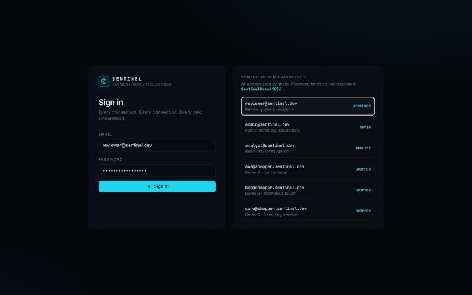

*Sign-in page with the list of synthetic demo accounts.*

A single sign-in page serves staff and shoppers. Clicking a demo account fills the form. After sign-in, shoppers go to the storefront and staff to the console.

## 13.2 Customer marketplace (SENTINEL MERCHANT)

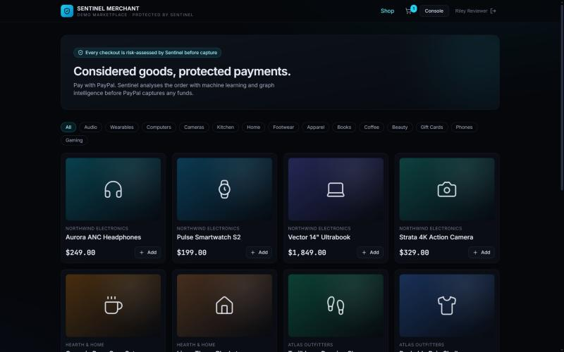

*Storefront catalogue with category filters.*

Shoppers browse 16 synthetic products from synthetic sellers and filter by category. The banner states that every checkout is risk-assessed before capture.

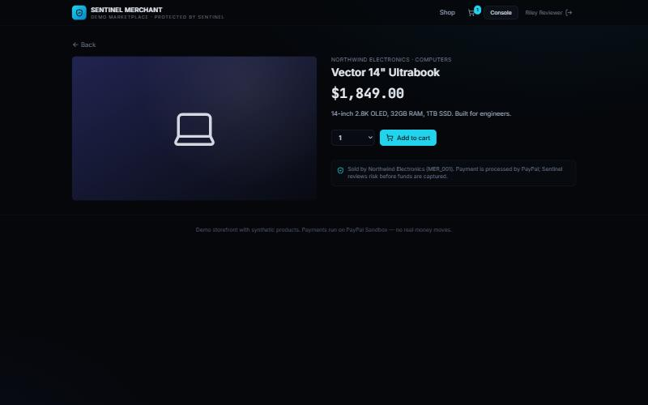

*Product detail page.*

The product page shows the seller, price and description, and explains that PayPal processes the payment while Sentinel reviews risk before funds are captured. If a shopper adds an item from a different seller, the cart refuses and explains that checkout is per seller.

## 13.3 Shopping cart and PayPal checkout

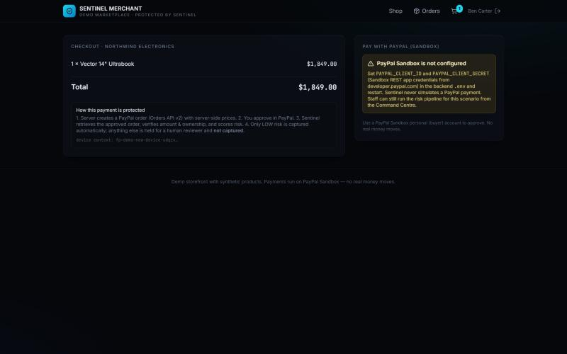

*Checkout for Demo B with PayPal not configured: the page explains the setup instead of faking a payment.*

The checkout summarises the order, explains the four protection steps and shows the device context. When PayPal is configured, PayPal Buttons appear here. When it is not, as in this screenshot, the page says so explicitly. After approval, a result screen shows **PayPal status** (order, capture, capture ID) and **Sentinel status** (decision, risk level, investigation) side by side.

## 13.4 Command Centre

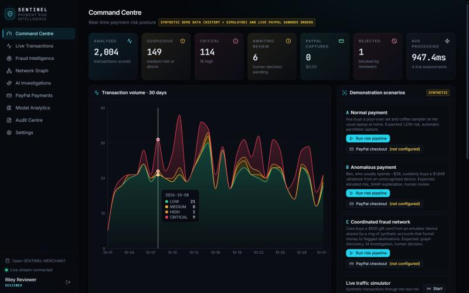

*Command Centre with KPIs, 30-day volume by risk level, and the demonstration launcher.*

The landing page for staff. KPI tiles: transactions analysed, suspicious, critical, awaiting review, PayPal captured, rejected and average processing time. Charts: 30-day volume stacked by risk level, risk distribution, fraud-probability histogram, fraud trend, PayPal and Sentinel status distributions, network summary, model performance and a live event stream. Every number comes from `GET /api/dashboard/metrics`. The demonstration panel runs scenarios A, B and C and starts or stops the synthetic traffic simulator.

## 13.5 Live Transactions

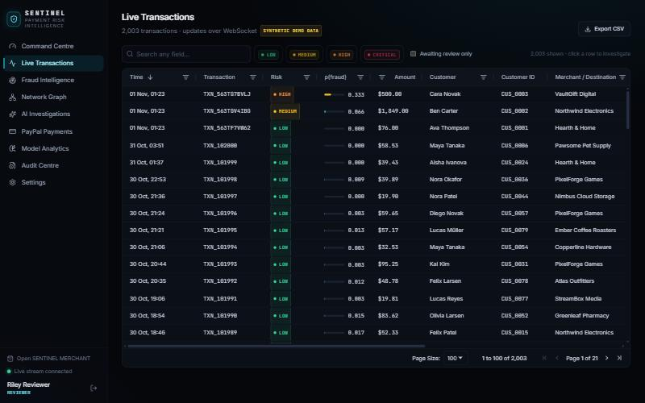

*Live Transactions grid (AG Grid) with risk chips, quick search and pagination.*

An AG Grid table of all transactions with column filters, sorting, quick search, risk-level chips, an "awaiting review only" toggle and CSV export. Clicking a row opens the investigation workspace.

## 13.6 Fraud Intelligence

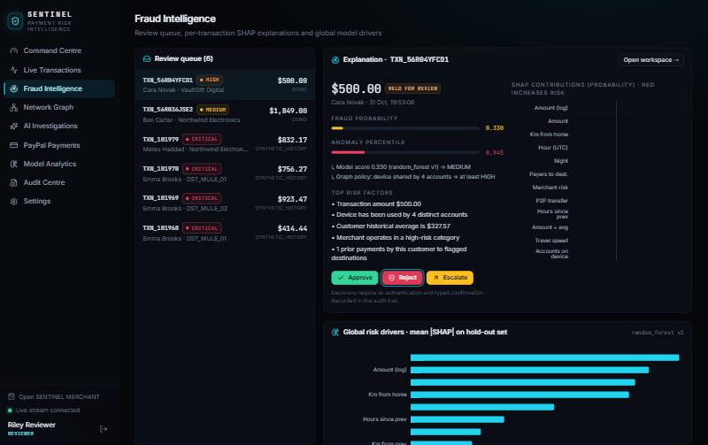

*Fraud Intelligence: review queue, per-transaction explanation and decision buttons.*

The review queue lists every payment awaiting a decision. Selecting one shows its fraud probability, anomaly percentile, policy notes, top risk factors and a SHAP chart, plus the Approve / Reject / Escalate buttons. Below, a global chart ranks the model's features by mean absolute SHAP value.

## 13.7 Network Graph

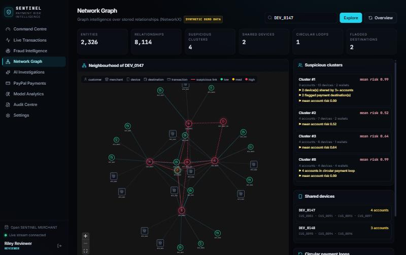

*Neighbourhood of device DEV_0147: red dashed edges are suspicious links.*

The Network Graph page starts with the overview of suspicious clusters (shown in Part 8) and lets a user search any customer, device or destination ID. Node colour shows risk; icons show type; red animated edges carry evidence. Hovering a node shows its details; clicking a node or edge opens an inspector with evidence and links to the underlying transactions. Side panels list suspicious clusters, shared devices, circular loops and flagged destinations.

## 13.8 AI Investigation workspace

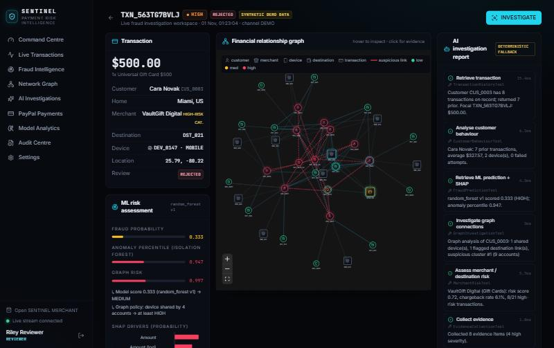

*Investigation workspace: transaction (left), relationship graph (centre), AI report steps (right).*

The signature screen. Left: transaction details and ML assessment. Centre: the relationship graph around the transaction. Right: the AI investigation with every step, its tool, duration and summary. The INVESTIGATE button starts a new run.

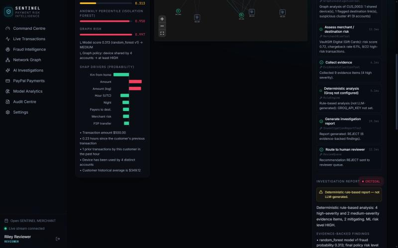

*Workspace (scrolled): SHAP drivers on the left; agent steps and the start of the report on the right.*

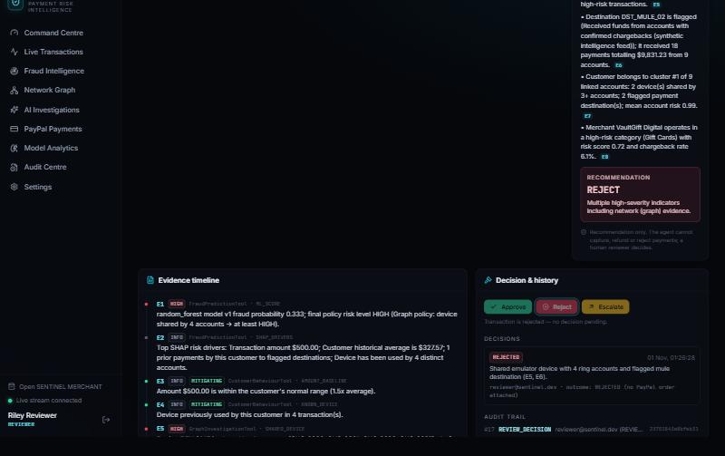

*Workspace (bottom): evidence-cited findings, the REJECT recommendation, the evidence timeline and the decision history.*

The bottom panels show the evidence timeline (E1...En with severity and mitigating flags), the decision buttons, the PayPal order block when one exists, recorded decisions and the audit trail with hash prefixes.

## 13.9 AI Investigations list

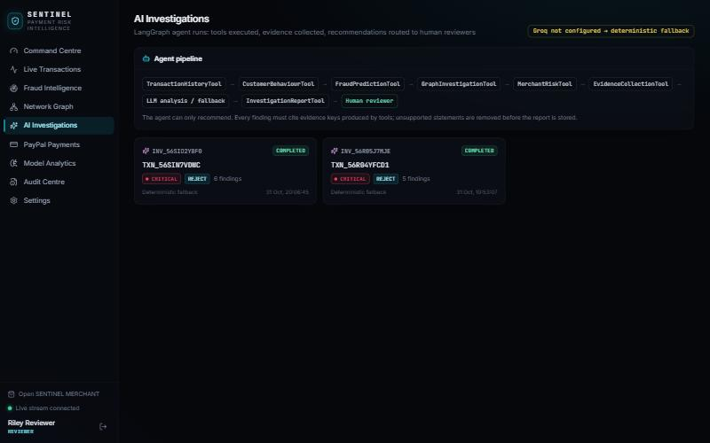

*AI Investigations: agent pipeline and completed runs.*

Shows the agent pipeline, the current mode (LLM or deterministic fallback) and every investigation with its recommendation and number of findings.

## 13.10 PayPal Payments

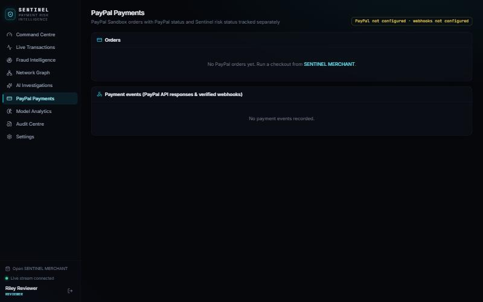

*PayPal Payments page: empty because PayPal was not configured during development.*

When PayPal is configured, this page lists every order with PayPal status, capture status and capture ID, Sentinel status and risk, plus a "Sync" button that refreshes from PayPal. Below, every PayPal API response and verified webhook is listed with HTTP status and debug ID. It is empty in this screenshot because no live Sandbox orders were created.

## 13.11 Model Analytics

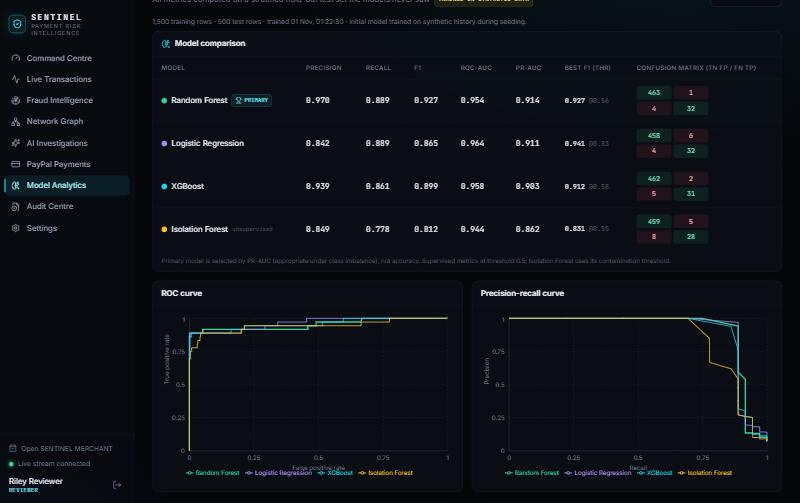

*Model Analytics: hold-out metrics, confusion matrices, ROC and precision-recall curves.*

Compares the four models, marks the primary, shows confusion matrices and ROC / PR curves, and lets an ADMIN retrain.

## 13.12 Audit Centre and Settings

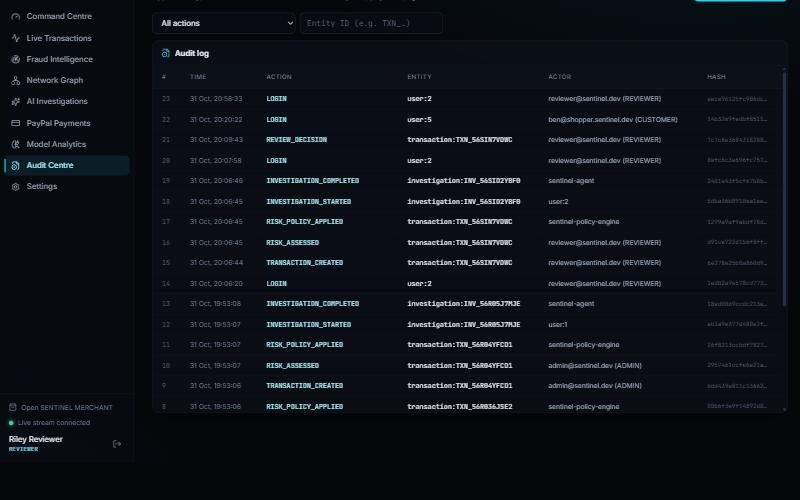

*Audit Centre: hash-chained log of every action.*

The audit log can be filtered by action or entity ID. "Verify hash chain" recomputes every hash; at capture time it reported "Chain intact: 18 entries verified".

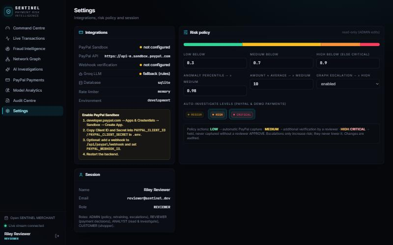

*Settings: integration status and the risk policy editor.*

Settings shows the PayPal, webhook, Groq, database and rate-limiter status, setup steps for PayPal, and the risk policy (editable by ADMIN; all changes are audited).

# PART 14: Demonstration Scenarios

Scenarios are launched from the Command Centre. **"Run risk pipeline"** sends a DEMO transaction through the real risk engine without creating a PayPal order. **"PayPal checkout"** sets the shopper persona and device and opens the real checkout (requires Sandbox credentials). The outputs below are from actual runs of "Run risk pipeline" on the development machine.

## Scenario A: Normal payment

| Aspect | Detail |
|---|---|
| Initial conditions | Ava Thompson (CUS_0001), San Francisco, 22 prior purchases averaging about $55, always on her laptop. |
| User action | Buys a Ceramic Pour-Over Set ($48) and Single-Origin Sampler ($28): $76.00, same laptop, at home. |
| Backend processing | Transaction created, 26 features computed, prediction stored, policy applied. |
| ML analysis | Fraud probability 0.000, LOW. No escalation rules triggered. |
| Graph analysis | No shared devices, cycles or flagged destinations. |
| AI investigation | Not triggered (LOW). |
| Payment workflow | Status CLEARED. Through PayPal checkout, Sentinel would call capture automatically. |
| Final result | Cleared for capture. Audit entries: TRANSACTION_CREATED, RISK_ASSESSED, RISK_POLICY_APPLIED. |

## Scenario B: Unusual transaction

| Aspect | Detail |
|---|---|
| Initial conditions | Ben Carter (CUS_0002), Chicago, 20 prior purchases averaging about $38. |
| User action | Buys a Vector 14" Ultrabook, $1,849.00, from a device he has never used. |
| ML analysis | Fraud probability 0.066 (would be LOW on its own). Anomaly percentile 0.954. Top SHAP factors: transaction amount $1,849.00; amount is 43.4x the customer's historical average; first time this customer has used this device. |
| Policy | "Amount is 43.4x customer average (>= 10.0x) -> at least MEDIUM". |
| Graph analysis | Nothing suspicious. |
| AI investigation | Not auto-triggered at MEDIUM (configurable); can be started with INVESTIGATE. |
| Payment workflow | HELD_FOR_VERIFICATION, review status PENDING_REVIEW. Through checkout, PayPal would show APPROVED and not captured. |
| Final result | Waits in the review queue for a human. |

This scenario shows why policy rules complement the model: the model, trained on synthetic data that includes legitimate large purchases, gave a low score, and the explicit amount rule plus the explanation put it in front of a reviewer.

## Scenario C: Coordinated synthetic fraud network

| Aspect | Detail |
|---|---|
| Initial conditions | Cara Novak (CUS_0003) is part of a 9-account cluster; the emulator device DEV_0147 is shared by 4 accounts; the cluster sent money to flagged wallets DST_MULE_01 and DST_MULE_02. |
| User action | Buys a $500 Universal Gift Card (VaultGift Digital, high-risk category) on the emulator device. |
| ML analysis | Fraud probability 0.333, MEDIUM by threshold. Anomaly percentile 0.947. |
| Graph analysis | "Graph policy: device shared by 4 accounts -> at least HIGH". Graph risk score 0.997. |
| AI investigation | Started automatically. 8 evidence items, 4 high severity; deterministic fallback report (Groq not configured); recommendation REJECT; 5 evidence-backed findings (Part 9.7). |
| Human decision | Reviewer re-authenticated, typed the transaction ID and rejected: "Shared emulator device with 4 ring accounts and flagged mule destination (E5, E6)." |
| Payment workflow | Transaction REJECTED. Through PayPal checkout the order would remain APPROVED and never be captured. |
| Audit trail | TRANSACTION_CREATED, RISK_ASSESSED, RISK_POLICY_APPLIED, INVESTIGATION_STARTED, INVESTIGATION_COMPLETED, REVIEW_DECISION. |

This is the clearest demonstration of the project's thesis: the transaction looked only moderately risky on its own, and the relationships revealed the fraud.

# PART 15: Testing and Results

## 15.1 Automated test suite

The backend has 26 automated tests (`pytest`) in `backend/tests`. They run against an isolated SQLite database that is seeded, trained and scored from scratch, and a **mock PayPal transport** that emulates Sandbox behaviour (OAuth, Orders v2, capture with `PayPal-Request-Id`, `ORDER_ALREADY_CAPTURED`, webhook verification). The mock is only used by tests.

Latest run: **26 passed, 0 failed (31.0 s)**.

| Test | Area | Checks |
|---|---|---|
| test_models_trained_with_honest_metrics | ML evaluation | All 4 models trained; metrics in [0,1]; confusion matrix sums to test rows; primary has best PR-AUC |
| test_ml_prediction_structure | ML prediction | Probability and anomaly in [0,1]; SHAP for every feature; positive top factors; missing values kept as null |
| test_baked_image_data_shifts_to_today | Deployment | Data baked into the image is shifted to end today, exactly |
| test_synthetic_world_is_independent_of_seed_time | Reproducibility | Same data whatever day or time the database is seeded |
| test_risk_classification_policy | Risk classification | Threshold mapping; escalation never lowers risk |
| test_transaction_creation_and_assessment | API | 401 unauthenticated, 403 shopper; risk payload; CLEARED status; audit entry; 422 on negative amount |
| test_anomalous_amount_escalates | Risk policy | Demo B is MEDIUM or higher and held; amount factor present |
| test_graph_detects_fraud_structures | Graph | DEV_0147 shared; 4-account cycle; both mule wallets; clean customer has no signals; evidence on edges; 404 unknown entity |
| test_incremental_graph_matches_full_rebuild | Graph | In-place graph updates match a full rebuild from the database |
| test_agent_tools_return_real_records | AI tools | Tools return real records; ToolError on unknown IDs; report tool drops invented and uncited findings; invalid recommendation normalised |
| test_investigation_workflow_deterministic_fallback | Agent workflow | All 7 tools run; labelled fallback; findings cite real keys; agent does not move money |
| test_rbac_and_auth | Security | 401 / 403 rules; forged token rejected; admin-only policy update |
| test_audit_chain_detects_tampering | Audit | Chain valid; modified row detected at the right ID; valid again after restore |
| test_investigations_persisted | Persistence | Completed investigation has evidence and the "recommendation only" notice |
| test_create_order_uses_server_side_prices | Payment | PayPal status CREATED; server price used |
| test_create_order_idempotency_key_replays | Idempotency | Same key returns same order; no second PayPal order |
| test_cart_validation | Input validation | Unknown product, mixed sellers, quantity 99 rejected |
| test_staff_cannot_create_checkout | RBAC | 403 for staff |
| test_capture_requires_buyer_approval | Payment state | 409 when order not approved |
| test_low_risk_payment_is_captured_once | Capture, duplicates | LOW captured; replays never call PayPal capture again (exactly 1 call) |
| test_payment_ownership_enforced | Ownership | Another shopper gets 403 |
| test_amount_mismatch_blocks_capture | Integrity | Tampered amount gives 409; no capture |
| test_high_risk_payment_cannot_bypass_review | Policy | HIGH held, APPROVED not captured, investigation started; direct capture refused (409) |
| test_reviewer_decision_controls | Review | Shopper 403, wrong password 401, wrong confirmation 422, short reason 422, escalation requires ADMIN, approve captures once, repeat 409 |
| test_reject_decision_never_captures | Review | REJECT leaves PayPal order APPROVED, uncaptured |
| test_webhook_signature_verification_and_dedupe | Webhooks | Forged or missing signature 400; valid processed; duplicate ignored |

## 15.2 Other verification performed

| Check | Result |
|---|---|
| Frontend type check (`tsc -b`) | Passed |
| Frontend production build (`vite build`) | Passed |
| Manual UI walkthrough in a browser | All 9 console sections, the investigation workspace, storefront, checkout (unconfigured) and a reviewer decision exercised |
| PostgreSQL DDL generation (`alembic upgrade head --sql`) | 18 tables generated for the PostgreSQL dialect |
| ML evaluation | Hold-out metrics in Part 7.6 |

## 15.3 Not yet verified

| Item | Reason |
|---|---|
| Live PayPal Sandbox order, approval and capture | Sandbox credentials were not available on the build machine |
| Live webhooks | Requires a public URL and webhook ID |
| Groq LLM investigation | No API key; fallback path tested instead |
| Docker Compose and PostgreSQL at runtime | Docker daemon was not running on the build machine |
| PayPal / Groq on the hosted deployment | Keys not configured on Render |
| Load and performance testing | Not performed |
| Frontend automated tests | None written |

# PART 16: Innovation and Differentiation

| Compared with | What Sentinel adds |
|---|---|
| Basic fraud detection (a single score) | Combines a supervised score, an anomaly percentile and graph signals; explains each payment with SHAP and policy notes; holds payments instead of auto-declining. |
| Traditional rule-based systems | Rules are kept, but as transparent escalations on top of learned models; thresholds are configurable and audited. |
| Basic AI chatbots | The agent works on real records through tools, must cite evidence, has a validator that removes unsupported claims, and cannot take irreversible actions. |
| Standalone payment apps | Risk decisions are enforced at PayPal's capture step with idempotency, ownership checks and bypass protection. |

The combination is the contribution: PayPal payment infrastructure, ML risk prediction, graph intelligence, an autonomous but bounded investigator, explainable recommendations and human-supervised decisions in one workflow.

**Limits of these claims:** Sentinel is a hackathon prototype. Commercial fraud platforms already combine many of these techniques at far larger scale with real data. We make no claim that Sentinel is the first or the best system of its kind, or that its accuracy would hold on real payments.

# PART 17: Limitations and Future Scope

## 17.1 Current limitations (implemented system)

- **Synthetic training data.** Patterns were designed by the author; some features (for example hour of day) are strong because of how the generator works.
- **No production validation.** Live PayPal Sandbox and Groq paths are implemented but were not executed during development.
- **Uncalibrated probabilities.** Class weighting shifts scores; they are risk scores rather than calibrated probabilities.
- **Single-process design.** WebSocket fan-out, feature state and graph cache live in one process.
- **CAPTURE intent.** Held orders must be decided within PayPal's approval window.
- **Simplified context.** Device identity is a random browser ID; checkout location defaults to the customer's home city unless a demo provides one.
- **In-sample history scores.** Historical transactions are scored by a model that was trained on most of them; only hold-out metrics measure quality.
- **No frontend tests**, no load testing and no formal security review.

## 17.2 Future scope (not implemented)

| Area | Proposed improvement |
|---|---|
| Data | Train and validate on real or public fraud datasets; time-based (out-of-time) validation. |
| Calibration | Isotonic or Platt calibration; cost-based threshold selection. |
| Monitoring | Feature drift, score drift and alerting; champion/challenger models. |
| Graph | Community detection (Louvain / Leiden), graph embeddings, graph neural networks, a graph database for scale. |
| Scale | Redis pub/sub or a message queue for events, a shared feature store, horizontal API scaling, streaming ingestion. |
| PayPal | AUTHORIZE-intent flow (authorise, then capture or void), refunds, disputes API, live webhook subscriptions, Vault. |
| Identity | Step-up verification for MEDIUM payments (one-time codes), stronger device intelligence. |
| Security | httpOnly cookie sessions, MFA for reviewers, penetration testing, secrets manager. |
| AI agent | Live Groq evaluation, prompt and report quality evaluation, multiple-model comparison. |
| Product | Case management, reviewer workload metrics, customer communication templates. |

# PART 18: Conclusion

Sentinel demonstrates that payment infrastructure and AI work best together when each does what it is good at. PayPal provides a real, idempotent payment lifecycle with a clear separation between a buyer's approval and the capture of funds. Machine learning estimates risk and, with SHAP, explains it. Graph analysis reveals coordinated behaviour that single-payment models miss, as Scenario C showed. An agentic investigator assembles the case file, but only from evidence that tools produced, and it can only recommend. Humans make the irreversible decisions, and everything is written to a tamper-evident log.

The engineering concepts combined are payment state machines and idempotency, point-in-time feature engineering, imbalanced classification and honest evaluation, explainable AI, graph algorithms, tool-using LLM agents with validation, role-based security and auditability.

The same pattern of "score, connect, investigate, explain, then let a human decide before money moves" could apply to marketplace payouts, peer-to-peer transfers, refund abuse or merchant onboarding. Sentinel is a prototype on synthetic data, but its architecture is a credible starting point for those problems.


# PART 19: Interview and Viva Preparation

Each question has a **short answer** (say this first), a **deeper explanation** (use it if they want more), and sometimes a **likely follow-up**. Answers describe the implementation as it actually is, including what was not verified.

## 19.1 Non-technical questions (20)

### Q1. What is Sentinel in one sentence?
**Short answer:** A layer that checks every PayPal checkout for fraud risk before the money is collected, and holds risky payments for a human.
**Deeper explanation:** It sits between the buyer approving in PayPal and the capture. Normal payments go through automatically; suspicious ones are explained, investigated by an AI agent and decided by a reviewer.
**Follow-up:** Why between approval and capture? Because that is the last moment you can stop money moving without refunding.

### Q2. What problem are you solving?
**Short answer:** Stopping fraudulent payments before they are captured, without blocking genuine customers, and explaining every decision.
**Deeper explanation:** Single-payment scores miss organised fraud and give no reasons. Sentinel adds relationship analysis, explanations, an investigator and human control.

### Q3. Who would use it?
**Short answer:** Merchants and their risk teams.
**Deeper explanation:** Shoppers use the storefront; reviewers and analysts use the console; admins tune the policy and retrain models.

### Q4. Why does fraud matter to a merchant?
**Short answer:** Fraudulent sales usually come back as chargebacks, so the merchant loses the goods, the money and fees.
**Deeper explanation:** Blocking too much is also costly, because genuine customers leave. The goal is balance, which is why Sentinel holds rather than declines.

### Q5. What does "held" mean for the customer?
**Short answer:** They approved the payment in PayPal, but no money has been taken yet.
**Deeper explanation:** The screen says the payment is under review and funds have not been captured. If approved, it is captured; if rejected, nothing is taken.

### Q6. What makes Sentinel different from a normal fraud filter?
**Short answer:** It looks at relationships between accounts, explains itself and keeps a human in control of irreversible actions.
**Deeper explanation:** In our demo C the model scored a payment at about 0.33, but the graph showed a shared emulator device and mule wallets, and the system raised it to HIGH.

### Q7. Where is the AI?
**Short answer:** In three places: the ML risk model, the anomaly detector and the investigation agent.
**Deeper explanation:** SHAP explains the model, and graph analysis provides network signals. The agent uses tools and writes an evidence-cited report.

### Q8. Does the AI make the final decision?
**Short answer:** No. It only recommends.
**Deeper explanation:** The agent has no payment tools. Reviewers must re-enter their password and type the transaction ID to decide.

### Q9. Is this used by PayPal?
**Short answer:** No. It is a hackathon prototype built on public PayPal Sandbox APIs and synthetic data.
**Deeper explanation:** It does not use or claim access to PayPal's internal fraud systems.

### Q10. Is real customer data used?
**Short answer:** No. All customers, merchants, devices and history are generated.
**Deeper explanation:** The generator is deterministic and labels its own fraud patterns. That makes demos reproducible but means accuracy claims are limited to synthetic data.

### Q11. What was the hardest part?
**Short answer:** Making the payment flow safe: no double captures, no bypassing review, and honest status.
**Deeper explanation:** That needed a compare-and-set lock, PayPal request IDs, ownership and amount checks, and separate PayPal and Sentinel status fields.

### Q12. What does a reviewer see?
**Short answer:** The transaction, the model's reasons, a relationship graph and the AI report with evidence.
**Deeper explanation:** Plus an evidence timeline, the decision history and the audit trail, all in one workspace.

### Q13. Why not just block suspicious payments automatically?
**Short answer:** Because false positives hurt genuine customers.
**Deeper explanation:** Holding gives a human the chance to verify. The policy is configurable if a business wants a stricter setup.

### Q14. How do you know it works?
**Short answer:** 26 automated tests pass, and the models are evaluated on held-out data.
**Deeper explanation:** Hold-out PR-AUC of the primary model is 0.914 on synthetic data. Live PayPal Sandbox and Groq paths have not yet been run with real credentials.

### Q15. What happens if PayPal is down?
**Short answer:** Sentinel returns a clear error with PayPal's debug ID and never pretends a payment succeeded.
**Deeper explanation:** If credentials are missing it returns 503 and the checkout explains the setup. Failed captures are marked `CAPTURE_FAILED` and can be retried safely.

### Q16. How long does a risk check take?
**Short answer:** Each assessment's latency is measured and stored; the dashboard shows the average.
**Deeper explanation:** On the development laptop the median was about 175 ms over 8 consecutive assessments; the first one after start-up takes about 0.7 s while the model and SHAP explainer load. That's a micro-benchmark, not a load test.

### Q17. What is the audit trail and why does it matter?
**Short answer:** A record of every action that is hash-chained, so changes are detectable.
**Deeper explanation:** Each entry includes the previous entry's hash. A verify button recomputes the chain; our test proves a modified row is detected.

### Q18. What would a judge see in three minutes?
**Short answer:** A normal payment cleared, an unusual one held with explanations, and a fraud ring found by the graph, investigated and rejected.
**Deeper explanation:** With credentials, A and C run through real PayPal Sandbox checkout.

### Q19. What did you learn?
**Short answer:** That safety in payments is mostly state management, and that AI is most useful when it is constrained.
**Deeper explanation:** Evidence validation and human-in-the-loop design mattered more than the choice of model.

### Q20. What would you do next?
**Short answer:** Run live Sandbox and Groq tests, then validate on real fraud data.
**Deeper explanation:** Then calibration, monitoring, an AUTHORIZE-intent flow and scaling the event system.

## 19.2 Technical questions (30)

### Q21. Describe the architecture.
**Short answer:** A React SPA, a FastAPI backend with risk, ML, graph and agent services, a relational database, and PayPal Sandbox.
**Deeper explanation:** REST plus one WebSocket; SQLAlchemy with Alembic; PostgreSQL in Docker/Render and SQLite locally; optional Redis for rate limiting; optional Groq for the LLM.

### Q22. Why FastAPI?
**Short answer:** Typed validation with Pydantic, automatic Swagger and native WebSockets in Python.
**Deeper explanation:** Python lets the API, ML and graph code share one process and one codebase.

### Q23. How does the frontend stay live?
**Short answer:** One authenticated WebSocket; events invalidate TanStack Query caches.
**Deeper explanation:** For example a `payment.updated` event refreshes orders, events and the transaction detail.

### Q24. How do background threads push WebSocket messages?
**Short answer:** The server's event loop is saved at start-up and threads use `asyncio.run_coroutine_threadsafe`.
**Deeper explanation:** The agent and simulator run in threads, so they cannot await directly.

### Q25. How is authentication done?
**Short answer:** bcrypt-hashed passwords and HS256 JWTs.
**Deeper explanation:** Role checks are FastAPI dependencies; the WebSocket validates the token from the query string and requires a staff role.

### Q26. What roles exist?
**Short answer:** ADMIN, REVIEWER, ANALYST and CUSTOMER.
**Deeper explanation:** Analysts read and investigate, reviewers decide, admins change policy, retrain and decide escalations, customers shop.

### Q27. How do you prevent a held payment from being captured?
**Short answer:** The capture function itself checks authorisation: LOW risk for automatic, or a stored APPROVE decision.
**Deeper explanation:** Even a direct call with `REVIEWER` authorisation is refused without a decision record. A test calls it directly and expects 409.

### Q28. How do you prevent duplicate captures?
**Short answer:** A database compare-and-set lock plus a stable PayPal-Request-Id.
**Deeper explanation:** `UPDATE ... SET capture_state='IN_PROGRESS' WHERE capture_state IN ('NONE','FAILED')`; only the winner calls PayPal. `ORDER_ALREADY_CAPTURED` is reconciled by reading the order.

### Q29. What is idempotency?
**Short answer:** Doing the same request twice has the same effect as doing it once.
**Deeper explanation:** Network retries and double clicks are normal, so payment APIs must be idempotent.

### Q30. How are prices protected?
**Short answer:** The server recalculates prices from its catalogue; the client total is display-only.
**Deeper explanation:** On approval, PayPal's amount must match the stored amount, otherwise the order is marked `INTEGRITY_FAILED`.

### Q31. Why can a cart only contain one seller?
**Short answer:** Each checkout creates one PayPal purchase unit and one transaction paying one merchant.
**Deeper explanation:** That keeps merchant risk and destination features meaningful. Multi-seller carts would need split payments.

### Q32. How is the transaction ID generated?
**Short answer:** Prefix plus a base-36 timestamp plus 3 random characters, for example `TXN_56SIN7VDWC`.
**Deeper explanation:** Synthetic history uses sequential IDs like `TXN_100542`.

### Q33. How does the risk policy work?
**Short answer:** Thresholds map probability to a level; escalation rules can only raise it.
**Deeper explanation:** LOW < 0.30 <= MEDIUM < 0.70 <= HIGH < 0.90 <= CRITICAL. Anomaly >= 0.98 or amount >= 10x average gives at least MEDIUM; graph signals give at least HIGH.

### Q34. Can the policy be changed?
**Short answer:** Yes, by an ADMIN in Settings; changes are validated and audited.
**Deeper explanation:** Thresholds must be strictly increasing; old and new values are stored in the audit log.

### Q35. What is stored for each prediction?
**Short answer:** Probability, anomaly and graph scores, level, action, top factors, SHAP values, features, policy notes and latency.
**Deeper explanation:** This lets you reconstruct exactly why a decision was made, even after a model is retrained.

### Q36. How do you handle model versions?
**Short answer:** Each training run creates a version with one row per algorithm; one is marked primary.
**Deeper explanation:** Artifacts are stored as joblib bundles; old versions remain. If the active artifact is missing at start-up, the backend retrains.

### Q37. How does the audit hash chain work?
**Short answer:** Each row's hash is SHA-256 over its content and the previous hash.
**Deeper explanation:** Verification reads rows in order (bypassing cached objects) and recomputes. A modified row breaks the chain at that row.

### Q38. Why store PayPal events separately?
**Short answer:** To keep a raw record of every PayPal response and webhook.
**Deeper explanation:** It includes HTTP status and `paypal-debug-id`, which PayPal support asks for.

### Q39. How is rate limiting implemented?
**Short answer:** Fixed windows in Redis if configured, otherwise a sliding window in memory.
**Deeper explanation:** Login 10/min, create-order and capture 20/min, webhook 300/min, general default configurable.

### Q40. How do you handle CORS?
**Short answer:** An explicit allow-list from `CORS_ORIGINS`, limited methods and headers.
**Deeper explanation:** Allowed headers are Authorization, Content-Type and Idempotency-Key.

### Q41. How are secrets kept out of logs?
**Short answer:** A logging filter redacts bearer tokens, client secrets and access tokens.
**Deeper explanation:** The PayPal secret is only used for OAuth with HTTP basic auth.

### Q42. How is the system deployed?
**Short answer:** Docker Compose locally, or a Render Blueprint with managed PostgreSQL.
**Deeper explanation:** The live demo runs the backend on Render's free plan (a Docker image that seeds and trains at build time and uses SQLite) and the frontend on Netlify. Docker Compose with PostgreSQL is configured for local use but was not run on the build machine.

### Q43. What happens on first start?
**Short answer:** Migrations run, the synthetic world is generated, models are trained and history is scored.
**Deeper explanation:** About 30 to 60 seconds on the development laptop.

### Q44. How are migrations handled?
**Short answer:** Alembic, run programmatically at start-up.
**Deeper explanation:** One initial migration creates 18 tables; offline SQL generation for PostgreSQL was checked.

### Q45. How did you test PayPal without credentials?
**Short answer:** With an httpx `MockTransport` that emulates PayPal Sandbox endpoints, in tests only.
**Deeper explanation:** It implements OAuth, order create/get/capture with request-ID idempotency, already-captured errors and webhook verification. The live Sandbox path still needs a real run.

### Q46. How does the graph explorer layout work?
**Short answer:** Kamada-Kawai layout per connected component, computed on the server.
**Deeper explanation:** Coordinates are returned with the nodes; React Flow renders them and fits the view after nodes are measured.

### Q47. Why AG Grid?
**Short answer:** Filtering, sorting, quick search, pagination and CSV export over thousands of rows.
**Deeper explanation:** We used the Community edition; row grouping is Enterprise, so we used risk filter chips.

### Q48. What would break first at scale?
**Short answer:** The in-process feature state, graph cache and WebSocket fan-out.
**Deeper explanation:** They assume one process. You would need a shared feature store, a graph store and pub/sub.

### Q49. How would you scale to millions of transactions?
**Short answer:** Stream ingestion, a shared online feature store, a model-serving tier, incremental graph updates in a graph database, and a message bus for events.
**Deeper explanation:** Keep the capture lock in the database, partition by customer, cache graph signals per entity, and run investigations asynchronously from a queue.

### Q50. What is the biggest technical debt?
**Short answer:** Single-process caches and untested live integrations.
**Deeper explanation:** Plus no frontend tests and uncalibrated probabilities.

## 19.3 Machine learning questions (15)

### Q51. Why did you choose XGBoost?
**Short answer:** It is a strong default for tabular data, but Sentinel does not force it: the primary model is whichever has the best PR-AUC.
**Deeper explanation:** In v1 Random Forest won (0.914) narrowly over Logistic Regression (0.911) and XGBoost (0.903). We report that honestly.
**Follow-up:** Why might XGBoost lose here? The data is small (1,500 training rows), and bagging is more stable on small, noisy data.

### Q52. Why is accuracy insufficient for fraud detection?
**Short answer:** With 7% fraud, predicting "never fraud" is 93% accurate and useless.
**Deeper explanation:** Precision, recall and PR-AUC focus on the rare class.

### Q53. What is the difference between precision and recall?
**Short answer:** Precision is how many flagged payments are really fraud; recall is how much fraud we flag.
**Deeper explanation:** Raising the threshold usually increases precision and lowers recall. The primary model had precision 0.970 and recall 0.889 at 0.5.

### Q54. Why PR-AUC over ROC-AUC for selection?
**Short answer:** PR-AUC reflects performance on the rare class; ROC-AUC can look good because there are so many true negatives.
**Deeper explanation:** Logistic Regression had the best ROC-AUC (0.964) but lower precision (0.842).

### Q55. How did you handle class imbalance?
**Short answer:** Class weights for LR and RF, `scale_pos_weight` for XGBoost, and stratified splitting.
**Deeper explanation:** No oversampling such as SMOTE was used, which avoids creating synthetic minority points.

### Q56. What is data leakage and how did you avoid it?
**Short answer:** Using information that would not be available at prediction time.
**Deeper explanation:** Features use only earlier transactions; imputation is fitted on training data; labels are never features; the destination "flagged" status is external intelligence, not derived from labels.

### Q57. Explain point-in-time features.
**Short answer:** Each transaction's features are computed from history before its timestamp.
**Deeper explanation:** The same `FeatureState` class is used in training (replay) and serving (state from the database), so definitions match.

### Q58. How do you handle missing values?
**Short answer:** Keep them as NaN and impute the training median inside each pipeline.
**Deeper explanation:** First-time customers have no average, previous location or interval. `is_first_txn` makes that explicit.

### Q59. What is Isolation Forest used for?
**Short answer:** An unsupervised anomaly percentile used by the policy and shown to reviewers.
**Deeper explanation:** It is trained without labels; its PR-AUC (0.862) is reported for transparency.

### Q60. What is SHAP?
**Short answer:** A method that splits a prediction into per-feature contributions based on Shapley values.
**Deeper explanation:** TreeExplainer for tree models, LinearExplainer for LR; positive contributions become reviewer-readable sentences.
**Follow-up:** What space are the values in? Probability for Random Forest; log-odds for XGBoost and LR.

### Q61. What are the most important features?
**Short answer:** Amount, log amount, hour of day, distance from home and night-time.
**Deeper explanation:** Hour and night rank high because the synthetic ring operates at night, a generator artefact we disclose.

### Q62. Are your probabilities calibrated?
**Short answer:** No; they are risk scores.
**Deeper explanation:** Class weighting shifts them. Isotonic or Platt calibration is future work.

### Q63. What happens if the model wrongly flags a genuine customer?
**Short answer:** The payment is held, not declined, and a reviewer can approve it, which captures the payment.
**Deeper explanation:** That approval is recorded and becomes a "legitimate" label for the next retraining.

### Q64. How would you evaluate on real data?
**Short answer:** Out-of-time validation, cost-weighted metrics and monitoring after launch.
**Deeper explanation:** Train on earlier months, test on later months, and choose thresholds by expected loss rather than F1.

### Q65. How is the model retrained?
**Short answer:** ADMIN triggers `POST /api/models/retrain`; a new version is created.
**Deeper explanation:** Labels come from synthetic ground truth and reviewer decisions on live payments.

## 19.4 Backend and database questions (15)

### Q66. Why SQLAlchemy and not raw SQL?
**Short answer:** One model layer for PostgreSQL and SQLite with type safety.
**Deeper explanation:** It still allows explicit atomic updates like the capture lock.

### Q67. Why both PostgreSQL and SQLite?
**Short answer:** PostgreSQL for deployment, SQLite for zero-setup local runs.
**Deeper explanation:** Render provides `postgres://` URLs, which the config converts for the psycopg 3 driver.

### Q68. What constraints protect data integrity?
**Short answer:** Foreign keys, check constraints and unique keys.
**Deeper explanation:** Examples: amount > 0, allowed statuses, allowed roles, unique PayPal order ID, idempotency key, capture ID and webhook event ID.

### Q69. Why is `transaction_id` unique in `paypal_orders`?
**Short answer:** One Sentinel transaction maps to exactly one PayPal order.
**Deeper explanation:** It prevents two orders paying for the same transaction.

### Q70. How do you store JSON?
**Short answer:** SQLAlchemy JSON columns.
**Deeper explanation:** Used for metrics, SHAP values, features, policy notes, investigation steps, reports and raw PayPal payloads.

### Q71. How are timestamps handled?
**Short answer:** Timezone-aware UTC.
**Deeper explanation:** SQLite drops timezone info, so an `aware()` helper re-attaches UTC.

### Q72. What indexes exist?
**Short answer:** On foreign keys, statuses, risk levels and composite customer+time and device+time.
**Deeper explanation:** The composite indexes support history queries for features and tools.

### Q73. How are errors returned?
**Short answer:** Consistent JSON with appropriate HTTP status codes.
**Deeper explanation:** 422 has a structured `errors` list; 502 for PayPal errors includes the debug ID; unhandled errors return a generic 500.

### Q74. How are long-running tasks handled?
**Short answer:** Background threads for investigations, the simulator and retraining.
**Deeper explanation:** Each uses its own database session. A queue (Celery, RQ) would be the production choice.

### Q75. How do you avoid two investigations of the same transaction?
**Short answer:** If one is RUNNING, its ID is returned instead of starting another.
**Deeper explanation:** The test for demo C relies on this deduplication.

### Q76. How does `GET /api/transactions/{id}` build the case?
**Short answer:** It joins the transaction, related entities, predictions, investigations, decisions, PayPal order, events and audit rows.
**Deeper explanation:** That single call powers the workspace's left and bottom panels.

### Q77. How is the latest prediction per transaction selected?
**Short answer:** A subquery on `max(id)` grouped by transaction.
**Deeper explanation:** Used by lists, the review queue and the graph engine.

### Q78. What happens if a decision call fails halfway?
**Short answer:** Decision and audit are committed before the capture, so the record exists even if PayPal fails.
**Deeper explanation:** A failed capture sets `CAPTURE_FAILED`; the lock moves to FAILED and allows a safe retry with the same PayPal-Request-Id.

### Q79. Why is the webhook handler run in a thread pool?
**Short answer:** It reads the raw body asynchronously, then runs blocking database and HTTP code in a worker thread.
**Deeper explanation:** This keeps the event loop free.

### Q80. What found a bug late in development?
**Short answer:** Copying `.env.example` to `.env` made `DATABASE_URL` blank and broke start-up.
**Deeper explanation:** Fixed with `env_ignore_empty=True` in the settings, so blank values fall back to defaults.


## 19.5 PayPal integration questions (15)

### Q81. How does PayPal Sandbox work?
**Short answer:** It is PayPal's test environment with test business and personal accounts and the same REST APIs, but no real money.
**Deeper explanation:** You create a Sandbox REST app for a client ID and secret, and approve payments with a Sandbox personal account.

### Q82. What is the difference between order creation and payment capture?
**Short answer:** Creation defines what will be paid; capture actually moves the money after the buyer approves.
**Deeper explanation:** Created, then Approved (buyer), then Completed (capture). Sentinel's risk check sits between approval and capture.

### Q83. Which PayPal APIs do you call?
**Short answer:** OAuth token, Orders v2 create, get and capture, and webhook signature verification.
**Deeper explanation:** `/v1/oauth2/token`, `/v2/checkout/orders`, `/v2/checkout/orders/{id}`, `/v2/checkout/orders/{id}/capture`, `/v1/notifications/verify-webhook-signature`.

### Q84. Where does the PayPal secret live?
**Short answer:** Only in the backend environment.
**Deeper explanation:** The browser gets only the public client ID from `/api/paypal/config`.

### Q85. Why intent CAPTURE and not AUTHORIZE?
**Short answer:** It is simpler and the approval-then-capture gap is enough to gate risk.
**Deeper explanation:** AUTHORIZE would hold funds longer and allow an explicit void on rejection. It is listed as future scope.

### Q86. What does PayPal-Request-Id do?
**Short answer:** It makes a PayPal POST idempotent: repeating it returns the original result.
**Deeper explanation:** Sentinel uses the client's Idempotency-Key for creation and `capture-{order_id}` for capture.

### Q87. How do you verify the order before capture?
**Short answer:** GET the order from PayPal and check status, amount, currency, reference and ownership.
**Deeper explanation:** Status must be APPROVED; a mismatch returns 409 and nothing is captured.

### Q88. How are webhooks verified?
**Short answer:** By calling PayPal's verify-webhook-signature API with the transmission headers and webhook ID.
**Deeper explanation:** Only `verification_status = SUCCESS` is accepted; event IDs are de-duplicated.

### Q89. Which webhook events are handled?
**Short answer:** Order approved and capture completed, denied, pending, refunded and reversed.
**Deeper explanation:** They update `paypal_status` and `capture_status`, and are stored in `payment_events`.

### Q90. What if the buyer cancels in PayPal?
**Short answer:** No approval happens, so nothing is assessed or captured.
**Deeper explanation:** The checkout shows "Checkout cancelled in PayPal. Nothing was charged."

### Q91. What if capture returns PENDING?
**Short answer:** Sentinel records PENDING and does not mark the transaction captured.
**Deeper explanation:** A later `PAYMENT.CAPTURE.COMPLETED` webhook would complete it.

### Q92. Did you test against live Sandbox?
**Short answer:** Not yet: the credentials were not available on the build machine.
**Deeper explanation:** The flow is fully tested against a mock transport. Running demos A and C with real Sandbox credentials is the next verification step.

### Q93. Do you use PayPal's fraud tools?
**Short answer:** No. Sentinel is a merchant-side layer using public APIs.
**Deeper explanation:** It complements, and does not replace or access, PayPal's own risk systems.

### Q94. How would you add refunds?
**Short answer:** Call the Captures refund API for a captured payment and handle refund webhooks.
**Deeper explanation:** Refund status would be stored as a PayPal-sourced field, with a reviewer action and an audit entry.

### Q95. Why is PayPal central rather than optional?
**Short answer:** The risk decision only matters because it controls a real capture.
**Deeper explanation:** PayPal's separation of approval and capture, request IDs and signed webhooks are part of the safety design.

## 19.6 AI agent and graph intelligence questions (15)

### Q96. What is LangGraph?
**Short answer:** A library for building LLM workflows as state machines with nodes and edges.
**Deeper explanation:** Sentinel's graph has nine nodes, from retrieving the transaction to routing the report to a reviewer, with a typed shared state.

### Q97. How does your AI agent use tools?
**Short answer:** Core tools always run in fixed steps; in LLM mode Groq can call extra tools before submitting a structured report.
**Deeper explanation:** Tool results become evidence keys, which the report must cite.

### Q98. What happens if Groq is unavailable?
**Short answer:** A deterministic rule-based report is produced and clearly labelled as not LLM-generated.
**Deeper explanation:** The reason (not configured, or the error) is stored in the report and shown in the UI.

### Q99. How do you prevent AI hallucinations?
**Short answer:** Evidence comes from tools, not the LLM, and the report validator removes any finding that does not cite a valid evidence key.
**Deeper explanation:** Invalid recommendations are normalised; if nothing valid remains, the rule-based report is used. Tests check that invented keys are removed.

### Q100. What is a structured output here?
**Short answer:** The `submit_investigation_report` tool call with a fixed schema.
**Deeper explanation:** risk_level, summary, findings with evidence_keys, recommendation from four allowed values, and rationale.

### Q101. Why can't the agent capture or reject payments?
**Short answer:** Those are irreversible financial actions and LLMs can be wrong.
**Deeper explanation:** The agent has no payment tools; humans decide with step-up authentication.

### Q102. What evidence categories exist?
**Short answer:** ML score, anomaly, SHAP drivers, amount, device, geography, impossible travel, card testing, velocity, shared device, flagged destination, circular payments, cluster and merchant risk.
**Deeper explanation:** Each has a severity, and some are marked mitigating, such as a known device or a normal amount.

### Q103. How does your graph detect suspicious relationships?
**Short answer:** Shared devices (3 or more accounts), money loops via `simple_cycles`, flagged-destination payments and connected clusters.
**Deeper explanation:** Merchant hubs are excluded from clustering so popular shops do not link everyone.

### Q104. Why exclude merchants from clusters?
**Short answer:** Almost every customer pays popular merchants, which would merge everyone into one component.
**Deeper explanation:** Devices and wallets are much stronger signals of common control.

### Q105. Did you implement community detection?
**Short answer:** No, connected components only.
**Deeper explanation:** Louvain or Leiden would find sub-communities inside large components; it is future scope.

### Q106. How is a circular payment found?
**Short answer:** Build a customer-to-customer graph from wallet transfers and search for cycles of length 3 to 6.
**Deeper explanation:** The synthetic loop CUS_0081 to 0082 to 0083 to 0080 moved $16,064.37.

### Q107. How does the graph affect the risk level?
**Short answer:** Graph signals raise risk to at least HIGH.
**Deeper explanation:** Triggers are a payment to a flagged destination, a device shared by 3 or more accounts, or a cycle member. A graph risk score is also stored.

### Q108. How is the graph kept current?
**Short answer:** Each assessed transaction is written to the graph tables and folded into the in-memory NetworkX engine incrementally.
**Deeper explanation:** Rebuilding from the database took about 500 ms, so the engine now updates in place under a lock and only re-runs the detection pass. A test checks that the result matches a full rebuild. At large scale you would still move to a graph store.

### Q109. What would a graph neural network add?
**Short answer:** Learned patterns over neighbourhoods instead of hand-written rules.
**Deeper explanation:** It needs more and real labelled data; it is future scope.

### Q110. What would you improve with six more months?
**Short answer:** Live PayPal and Groq validation, real data, calibration, monitoring and scale.
**Deeper explanation:** Also AUTHORIZE flow, community detection, step-up customer verification, frontend tests and a security review.

# PART 20: Personal Project Explanation

## 20.1 30-second elevator pitch

"I built Sentinel for the PayPal AI Hackathon. It protects PayPal checkouts by checking each payment after the buyer approves it but before the money is captured. It combines a machine-learning risk model, a graph that spots fraud rings through shared devices and mule wallets, and an AI investigator that writes an evidence-backed report. Normal payments go straight through; risky ones are held until a reviewer approves them. Everything is explained and audited."

## 20.2 Two-minute explanation

"Most fraud checks give you a score for one payment. Two things are missing: organised fraud looks normal one payment at a time, and a score without reasons still leaves someone to investigate.

Sentinel is a payment layer on top of PayPal. Our demo shop creates a real PayPal Sandbox order on the server. After the buyer approves, and before we capture, we fetch the order from PayPal, check the amount and that it belongs to the shopper, and score it. The score uses 26 features computed only from earlier transactions, from a Random Forest that was picked automatically because it had the best PR-AUC on held-out data, plus an Isolation Forest for anomalies and SHAP to explain the result.

Then the graph. We store every relationship between customers, devices, wallets and merchants, and NetworkX finds shared devices, money loops and clusters. In our third demo the model only gave about 0.33, but the device was shared with three other accounts paying flagged wallets, so the policy raised it to HIGH.

High-risk payments get an AI investigation built with LangGraph: seven tools collect evidence, and every finding has to cite an evidence item or it is removed. The agent can only recommend. A reviewer re-enters their password and approves, rejects or escalates, and only an approval lets PayPal capture. There are 26 automated tests, including ones that prove a high-risk payment can't be captured without approval and nothing is captured twice."

## 20.3 Five-minute technical explanation

"Let me walk through the stack and the guarantees.

**Frontend:** React and TypeScript with Vite and Tailwind. TanStack Query handles data, and one WebSocket invalidates queries so the console is live. React Flow draws the graph, Recharts the charts, AG Grid the transaction table, and the PayPal React SDK renders the buttons with only the public client ID.

**Backend:** FastAPI with Pydantic validation, SQLAlchemy and Alembic, PostgreSQL for deployment and SQLite locally. JWT auth with four roles.

**Payment lifecycle:** create-order recalculates prices on the server, creates a transaction and calls Orders v2 with intent CAPTURE, using the client's Idempotency-Key as PayPal-Request-Id. On capture-order we GET the order, require APPROVED, match amount, currency, reference and owner, then run risk. PayPal status is only written from PayPal responses; Sentinel status is separate. Capture uses a compare-and-set update so only one request proceeds, plus a stable PayPal-Request-Id and reconciliation if PayPal says it was already captured. The capture function re-checks authorisation: LOW risk, or a stored APPROVE decision.

**ML:** a deterministic synthetic world with labelled fraud patterns plus deliberate noise. Point-in-time features via one FeatureState class for training and serving. Stratified 75/25 split, class weights, four models, metrics on the hold-out only. Random Forest won with PR-AUC 0.914; XGBoost was third. SHAP gives per-payment explanations.

**Policy:** thresholds map to LOW, MEDIUM, HIGH or CRITICAL; escalations for anomaly, 10x amount and graph signals only raise risk.

**Graph:** relationships persisted in tables, loaded into NetworkX, transaction nodes collapsed into an entity projection. Shared devices, simple_cycles for loops, connected components excluding merchant hubs for clusters.

**Agent:** a nine-node LangGraph workflow. Evidence is generated deterministically from tool outputs; Groq can call more tools and must submit a structured report; a validator drops uncited findings; if Groq isn't available there's a labelled rule-based fallback.

**Audit and tests:** a SHA-256 hash-chained audit log with verification. 26 pytest tests with a mock PayPal transport. What I haven't verified yet is live Sandbox and live Groq, because I didn't have credentials on the build machine, and the models are only validated on synthetic data."

## 20.4 Resume description

**Sentinel: AI payment risk platform on PayPal (PayPal AI Hackathon 2026).** Built a full-stack payment protection layer (FastAPI, React/TypeScript) that risk-gates PayPal Orders v2 captures. Implemented point-in-time feature engineering and compared Random Forest, XGBoost, Logistic Regression and Isolation Forest (primary selected by hold-out PR-AUC 0.914 on synthetic data) with SHAP explanations; NetworkX graph detection of shared-device rings and circular payments; a LangGraph investigation agent with evidence-validated reports; idempotent, bypass-proof capture; and a hash-chained audit log. 26 automated tests.

## 20.5 LinkedIn description

I built Sentinel for the PayPal AI Hackathon 2026: a payment protection layer that checks every PayPal checkout between buyer approval and capture. It combines an ML risk model with SHAP explanations, graph analysis that finds fraud rings through shared devices and mule wallets, and a LangGraph AI investigator whose every claim must cite real evidence. Risky payments are held until a reviewer approves, and nothing can be captured twice. Built with FastAPI, React, scikit-learn, XGBoost, NetworkX, LangGraph and the PayPal Orders API on Sandbox with synthetic data.

## 20.6 GitHub repository description

Sentinel: AI-powered payment risk intelligence on PayPal Sandbox. ML + SHAP, NetworkX graph intelligence, LangGraph investigation agent, human-in-the-loop capture gating, hash-chained audit. FastAPI + React. Synthetic data.

## 20.7 Hackathon submission summary

Sentinel is a payment protection layer for PayPal checkouts. Between buyer approval and capture, it verifies the PayPal order, scores risk with an ML model (Random Forest selected by hold-out PR-AUC, explained with SHAP) and an anomaly detector, and checks a relationship graph for shared devices, mule wallets and money loops. LOW-risk payments are captured automatically; others are held, investigated by a LangGraph agent whose findings must cite tool-produced evidence, and decided by a re-authenticated human reviewer. Captures are idempotent and cannot bypass review, PayPal status and Sentinel status are kept separate, and every action is recorded in a hash-chained audit log. Built with FastAPI, React, scikit-learn, XGBoost, SHAP, NetworkX, LangGraph/Groq and PayPal Orders v2 on Sandbox, using synthetic data only.


---

# APPENDIX: Quick Overview

> A payment protection layer for PayPal checkouts: it decides, with evidence, whether money should move, and keeps a human in charge of irreversible decisions. Hackathon prototype on PayPal Sandbox and synthetic data.

## The problem

Fraud checks usually score one payment at a time and give no reasons. Organised fraud is designed to look normal payment by payment, and a bare score still leaves an analyst to investigate while the customer waits.

## What Sentinel does

1. The demo shop (SENTINEL MERCHANT) creates a real PayPal Orders v2 order on the server, with server-side prices.
2. The buyer approves in PayPal. No money has moved yet.
3. Sentinel fetches the order from PayPal, checks status, amount and ownership, and scores the risk.
4. LOW risk is captured automatically. Anything else is **held**: approved in PayPal, but not captured.
5. For HIGH risk, an AI agent investigates with seven tools and writes an evidence-cited report.
6. A reviewer re-authenticates and approves, rejects or escalates. Only approval triggers capture.
7. Every step is written to a hash-chained audit log.


*High-level system architecture*

## Key results (actual)

| Item | Result |
|---|---|
| Primary model (selected by hold-out PR-AUC) | Random Forest: precision 0.970, recall 0.889, F1 0.927, ROC-AUC 0.954, PR-AUC 0.914 (500-row test set, synthetic) |
| Other models | XGBoost PR-AUC 0.903; Logistic Regression 0.911; Isolation Forest 0.862 |
| Graph findings | 2 shared devices, 1 four-account money loop ($16,064), 2 flagged mule wallets, 4 suspicious clusters |
| Demo C | ML score 0.333 alone; graph raised it to HIGH; agent recommended REJECT with 5 evidence-backed findings |
| Automated tests | 26 passed, 0 failed |

## What makes it different

- Risk is enforced at the PayPal capture step, with idempotency and bypass protection.
- ML, anomaly detection and graph intelligence feed one explainable policy.
- The AI agent must cite evidence and can only recommend.
- PayPal status and Sentinel status are kept separate, so a held payment is never shown as paid.

## Technology

React, TypeScript, Vite, Tailwind, Recharts, React Flow, AG Grid, TanStack Query, PayPal JS SDK · FastAPI, Pydantic, SQLAlchemy, Alembic, PostgreSQL/SQLite, Redis (optional) · scikit-learn, XGBoost, SHAP, pandas, NumPy · NetworkX · LangGraph, Groq · Docker, Render.

## Honest status

| Verified | Not yet verified |
|---|---|
| Full app locally and live at https://sentinel-payment-risk.netlify.app (Render backend); 26 tests; UI walkthrough; hold-out ML metrics | Live PayPal Sandbox capture (no credentials yet); Groq LLM path (fallback used); Docker Compose with PostgreSQL |
