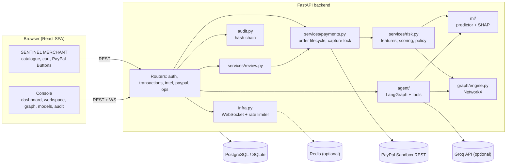
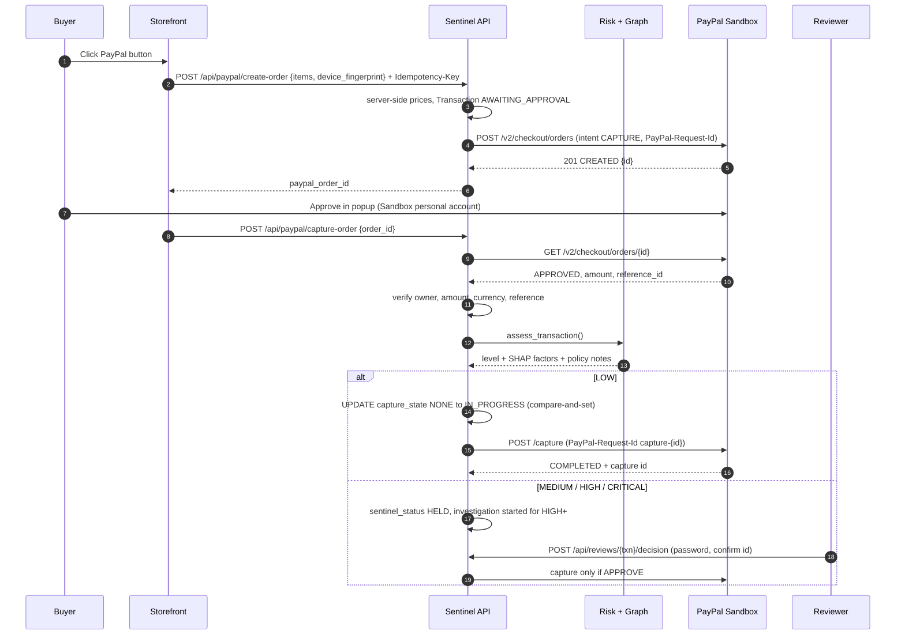
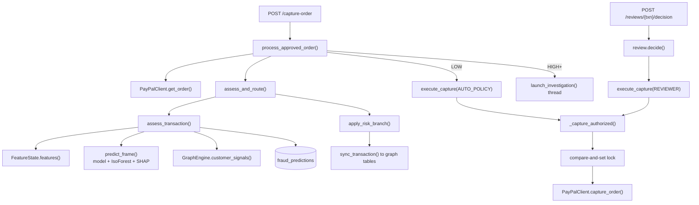
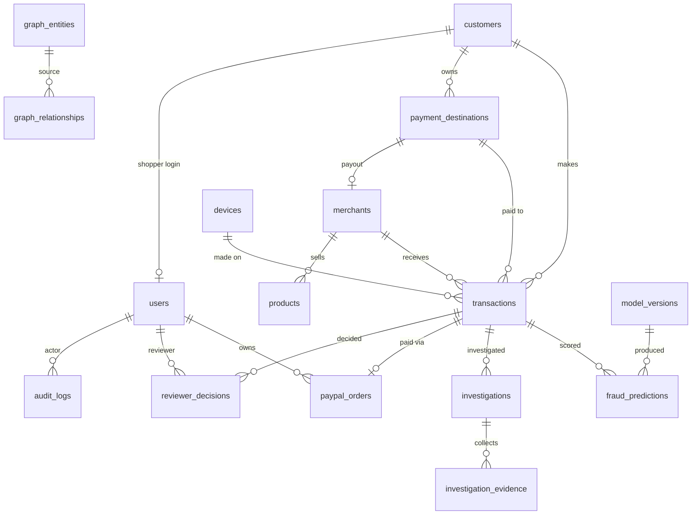
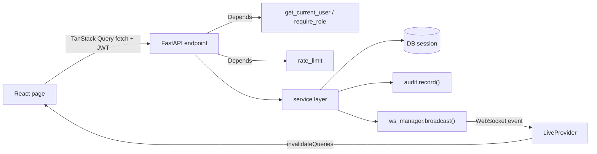
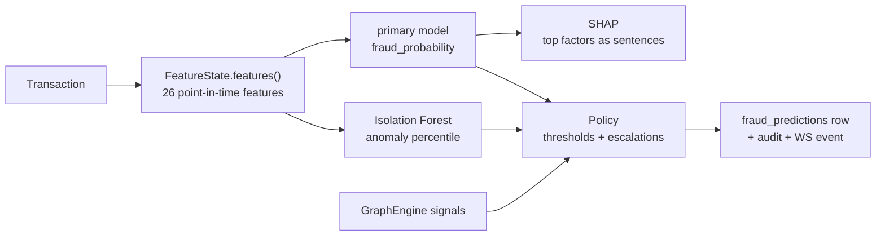
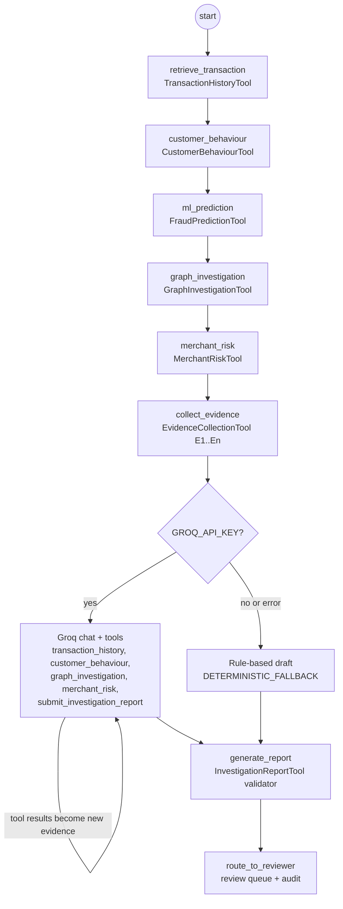
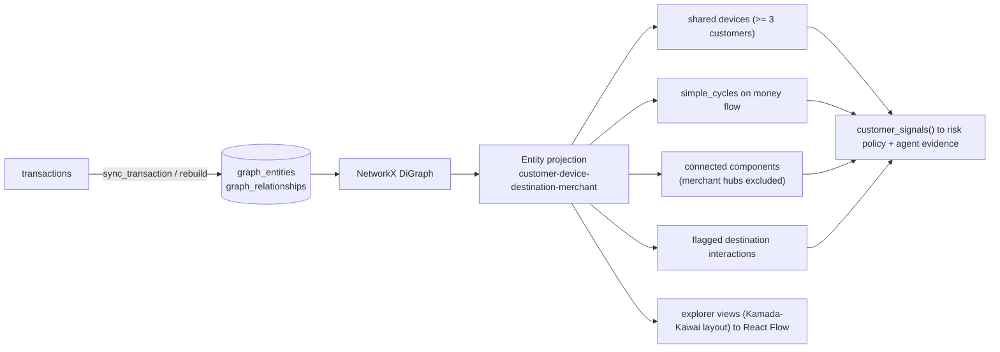
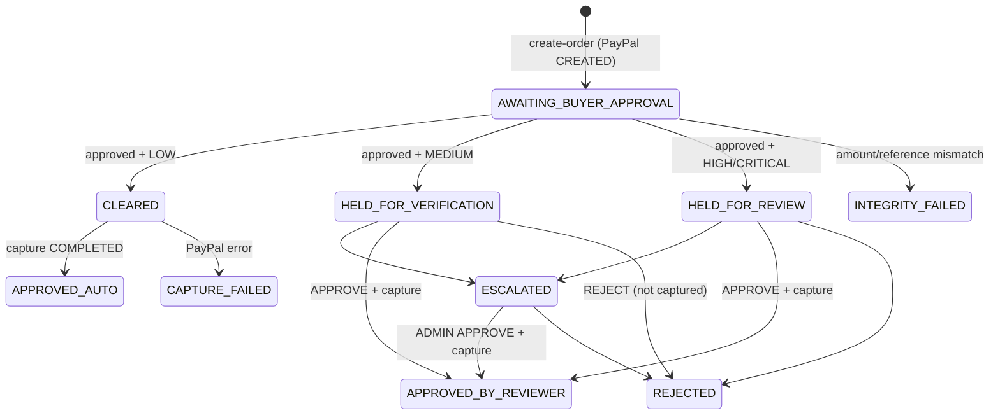
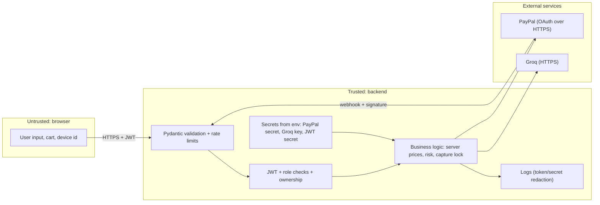

# SENTINEL Technical Architecture

This document describes the system as implemented in this repository (`backend/app`, `frontend/src`). Every diagram matches the code. Items that are configured but not executed, or not implemented, are marked as such.

## 1. High-level architecture

<!-- pdf:DIAGRAM:architecture -->

The browser runs one React application with two areas: the storefront for shoppers and the console for staff. The FastAPI backend holds all business logic and is the only component that talks to PayPal and Groq. State lives in a relational database: PostgreSQL in Docker/Render, SQLite for local development. Redis is optional and only used for shared rate-limit counters.

## 2. Transaction lifecycle

<!-- pdf:DIAGRAM:sequence -->

## 3. Component interaction

Both capture paths go through the same `execute_capture()`. That function re-checks authorisation itself (a LOW assessment for `AUTO_POLICY`, or a stored APPROVE decision for `REVIEWER`) before it takes the lock and calls PayPal.

## 4. Database ER diagram

<!-- pdf:DIAGRAM:erd -->

Key constraints: `transactions.amount > 0`, allowed status lists, unique `paypal_orders.paypal_order_id` / `transaction_id` / `create_idempotency_key` / `capture_id`, unique `payment_events.webhook_event_id`, unique `audit_logs.hash`, and composite indexes on customer+time and device+time. `payment_events` and `system_settings` have no foreign keys (events are keyed by PayPal order ID).

## 5. API communication flow

Requests carry `Authorization: Bearer <JWT>`. Validation errors return 422 with a structured list. PayPal errors return 502 with PayPal's `debug_id`. A missing PayPal configuration returns 503. Background work (investigations, simulator, retraining) runs in threads and pushes WebSocket events with `asyncio.run_coroutine_threadsafe`.

## 6. ML inference flow

<!-- pdf:DIAGRAM:mlpipeline -->

Training replays history chronologically through the same `FeatureState`, uses a stratified 75/25 split and class weighting, trains four models and selects the primary by hold-out PR-AUC (v1: Random Forest, PR-AUC 0.897 on synthetic data).

## 7. AI agent tool-calling flow

<!-- pdf:DIAGRAM:agent -->

The validator drops findings that cite no valid evidence key, normalises the recommendation, and falls back to the rule-based report if no supported findings remain. The agent has no payment tools. **The Groq path is implemented but has not been executed** (no API key was available); all recorded investigations used the labelled fallback.

## 8. Graph intelligence

<!-- pdf:DIAGRAM:graph -->

Community detection is **not implemented**; connected components are used instead.

## 9. PayPal payment flow and state

This diagram shows `sentinel_status`. `paypal_status` / `capture_status` are separate fields written only from PayPal responses and verified webhooks.

## 10. Security boundaries and data flow

| Boundary | Control |
|---|---|
| Browser to API | JWT, RBAC, Pydantic validation, rate limits, CORS allow-list, security headers |
| Client-supplied prices | Ignored; recalculated server-side, then re-verified against PayPal |
| Order ownership | Every order endpoint checks `user_id` (or staff role where allowed) |
| PayPal secret | Server environment only; browser receives only the client ID |
| Webhooks | Accepted only after PayPal's verify-webhook-signature returns SUCCESS; event IDs de-duplicated |
| Irreversible actions | Only humans (re-authenticated) can approve held captures; the agent has no payment tools |
| Audit | Hash-chained rows; `/api/audit/verify` detects modification |

## 11. Deployment

<!-- pdf:DIAGRAM:deployment -->

| Mode | Status |
|---|---|
| Local: Uvicorn + Vite, SQLite, in-memory limits | Running and verified |
| Docker Compose: postgres:16, redis:7, backend, nginx frontend | Configured, not run on the build machine |
| Render Blueprint: managed PostgreSQL, Docker API, static site | Configured, not deployed |
